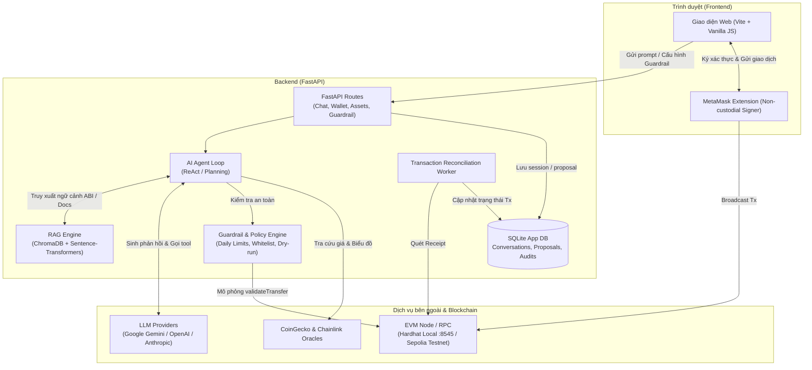

# AI Agent with Blockchain Tools

[](https://www.python.org/)
[](https://nodejs.org/)
[](https://soliditylang.org/)
[](https://hardhat.org/)
[](https://fastapi.tiangolo.com/)
[](LICENSE)

Hệ thống trợ lý ảo thông minh (**AI Agent**) hỗ trợ tương tác với mạng lưới **Blockchain (Ethereum / EVM)** bằng ngôn ngữ tự nhiên tiếng Việt và tiếng Anh. 

Ứng dụng kết hợp sức mạnh của **Mô hình ngôn ngữ lớn (LLM)**, **Retrieval-Augmented Generation (RAG)** và bộ công cụ **Web3**, tích hợp hệ thống **Guardrail bảo mật đa tầng** (Policy Engine, Hạn mức giao dịch, Giới hạn chi tiêu 24h, Whitelist, Dry-run simulation) cùng cơ chế **Human-in-the-Loop** (phê duyệt trên UI trước khi người dùng tự ký bằng ví MetaMask).

> **Đề tài môn học**: Các công nghệ tiên tiến (ATI) — Học viện Công nghệ Bưu chính Viễn thông (PTIT)  
> **Nhóm thực hiện**: Nhóm 15  

---

## 📑 Mục lục

- [Tính năng nổi bật](#-tính-năng-nổi-bật)
- [Kiến trúc hệ thống](#-kiến-trúc-hệ-thống)
- [Cấu trúc dự án](#-cấu-trúc-dự-án)
- [Yêu cầu môi trường](#-yêu-cầu-môi-trường)
- [Hướng dẫn cài đặt](#-hướng-dẫn-cài-đặt)
- [Hướng dẫn khởi chạy ứng dụng](#-hướng-dẫn-khởi-chạy-ứng-dụng)
- [Kết nối MetaMask & Kịch bản trải nghiệm](#-kết-nối-metamask--kịch-bản-trải-nghiệm)
- [Triển khai Sepolia Testnet](#-triển-khai-sepolia-testnet)
- [Kiểm thử & Đánh giá an toàn](#-kiểm-thử--đánh-giá-an-toàn)
- [Xử lý lỗi thường gặp](#-xử-lý-lỗi-thường-gặp)
- [Tài liệu kỹ thuật liên quan](#-tài-liệu-kỹ-thuật-liên-quan)
- [Thành viên nhóm](#-thành-viên-nhóm)

---

## 🌟 Tính năng nổi bật

### 1. Trò chuyện & Tương tác tự nhiên (Multilingual AI Agent)
- Hỗ trợ giao tiếp song ngữ mượt mà (**Tiếng Việt / English**).
- Tự động đồng bộ ngôn ngữ giữa giao diện người dùng và câu trả lời của Agent.
- Hiển thị trực quan quá trình suy luận (thought process), các bước gọi công cụ (tool calls) và kết quả trả về từ blockchain.

### 2. Tra cứu dữ liệu Blockchain (Read Tools)
- Tra cứu số dư tài sản gốc (`ETH`) và token tiêu chuẩn ERC-20 (`AGNT`).
- Kiểm tra thông tin smart contract: tên, biểu tượng, tổng cung, số thập phân (`decimals`).
- Ước tính phí gas thời gian thực và tra cứu trạng thái/lịch sử giao dịch.
- **Giá thị trường & Biểu đồ**: Tích hợp công cụ `get_token_price` lấy giá theo thời gian thực từ CoinGecko và Chainlink Price Feed Oracle (Sepolia), tự động render biểu đồ tương tác trong khung chat.

### 3. Chuẩn bị giao dịch & Faucet (Write Tools)
- Soạn thảo và khởi tạo giao dịch chuyển `ETH` hoặc chuyển token `AGNT`.
- Tích hợp **Faucet on-chain**: Cho phép người dùng nhận test token `AGNT` trực tiếp (tối đa 100 AGNT/lần, thời gian hồi cooldown 60 giây).

### 4. Hệ thống bảo mật & Guardrail đa tầng
- **Chính sách hạn mức (Limits)**: Giới hạn số lượng tối đa trên từng giao dịch (*Per-transaction limit*) và hạn mức chi tiêu tích lũy trong 24 giờ (*24h Daily Limit*).
- **Kiểm soát địa chỉ (Address Control)**: Xác thực checksum chuẩn EIP-55, tự động chặn zero-address và kiểm tra danh sách ví cho phép (*Whitelist*).
- **Mô phỏng trước khi gửi (Simulation Dry-Run)**: Tự động chạy thử qua hàm `validateTransfer` trên Smart Contract nhằm phát hiện lỗi revert trước khi người dùng thực hiện giao dịch.
- **Quản lý Guardrail trên UI**: Giao diện tab *Assets & Guardrail* cho phép tùy chỉnh hạn mức và thử nghiệm cơ chế chặn (Policy Evaluation block) trực tiếp.

### 5. An toàn Non-Custodial & Human-in-the-Loop
- **Non-custodial**: Backend **hoàn toàn không lưu trữ khóa riêng (private key)** của người dùng ở chế độ Browser Wallet.
- **Human-in-the-Loop**: Mọi hành động làm thay đổi trạng thái (chuyển token, claim faucet) bắt buộc phải tạo `Proposal`, yêu cầu người dùng xác nhận phê duyệt trên giao diện trước khi kích hoạt cửa sổ MetaMask để ký on-chain.
- **Đối soát giao dịch (Reconciliation Worker)**: Tự động theo dõi hash, đọc receipt từ RPC, phát hiện sai lệch payload và cập nhật trạng thái vào cơ sở dữ liệu SQLite theo từng ví.

---

## 🏛️ Kiến trúc hệ thống



### Phân tầng trách nhiệm

| Phân hệ | Công nghệ / Thư mục | Trách nhiệm chính |
|---|---|---|
| **Frontend** | ES Modules, HTML5, CSS3, Vite — `frontend/` | Giao diện chat, kết nối MetaMask, quản lý tab tài sản, cấu hình guardrail, hiển thị biểu đồ giá |
| **API & Server** | FastAPI, Uvicorn, Web3.py — `backend/` | API xác thực chữ ký ví (EIP-4361 style), quản lý proposal, lịch sử hội thoại |
| **AI Agent** | Python, Pydantic — `agent/`, `tools/`, `services/` | Vòng lặp Agent ReAct, tool registry, định dạng tham số gọi blockchain |
| **RAG Retrieval** | ChromaDB, Sentence-Transformers — `rag/`, `knowledge/` | Index hóa ABI, tài liệu smart contract và rule policy, ngăn chặn ảo giác (hallucination) |
| **Guardrail Engine** | Python, SQLAlchemy — `backend/guardrail/`, `security/` | Kiểm soát hạn mức 24h, whitelist, kiểm thử dry-run trước khi cấp quyền proposal |
| **Smart Contract** | Solidity 0.8.24, Hardhat, OpenZeppelin — `contracts/` | Token `AgentToken` (ERC-20, Faucet, Capped, Max Transfer Limit, Validate Transfer) |
| **Kiểm thử & E2E** | Pytest, Node Test Runner, Playwright — `tests/`, `eval/` | Unit test backend, Hardhat integration, Safety v2 benchmark, Chromium E2E testing |

---

## 📂 Cấu trúc dự án

```text
ai-agent-blockchain/
├── agent/                  # AI Agent core logic, prompts và context management
├── backend/                # FastAPI application
│   ├── abi/                # Contract ABI & deployment metadata (Local/Sepolia)
│   ├── api/                # API route handlers (chat, wallet, guardrails)
│   ├── db/                 # SQLAlchemy models, repositories, Alembic migrations
│   ├── guardrail/          # Triển khai quy tắc guardrail & đánh giá rủi ro
│   └── services/           # Dịch vụ ví, reconciliation, price service
├── contracts/              # Mã nguồn Smart Contracts (Hardhat project)
│   ├── contracts/src/      # AgentToken.sol (ERC-20 + Faucet + Guardrails)
│   ├── scripts/            # Script deploy & xuất ABI
│   └── test/               # Bộ 18 unit tests cho Smart Contract
├── data/                   # SQLite database (app.db) và RAG Vectorstore
├── docs/                   # Tài liệu thiết kế, runbook và báo cáo kỹ thuật
├── eval/                   # Bộ benchmark đánh giá an toàn (Safety v2)
├── frontend/               # Giao diện web người dùng (HTML, CSS, Vanilla JS)
│   ├── controllers/        # Quản lý session ví, tài sản, UI controller
│   ├── locales/            # Từ điển đa ngôn ngữ (en.json, vi.json)
│   └── tests/              # Frontend unit tests & Playwright E2E specs
├── knowledge/              # Tài nguyên tri thức văn bản dùng cho RAG
├── rag/                    # Pipeline chunking, embedding và vector retrieval
├── scripts/                # Bộ công cụ CLI: setup demo, ingest RAG, migration, E2E
├── tools/                  # Bộ công cụ Web3 của Agent (read/write tools)
├── .env.example            # File mẫu biến môi trường
├── pyproject.toml          # Cấu hình package Python
└── requirements.txt        # Danh sách thư viện Python được khóa phiên bản
```

---

## 💻 Yêu cầu môi trường

- **Hệ điều hành**: Windows 10/11 (hỗ trợ đầy đủ PowerShell), Linux hoặc macOS.
- **Python**: Phiên bản **3.12.x (x64)**.
- **Node.js**: Phiên bản **22.x LTS** (kèm `npm`).
- **Trình duyệt**: Google Chrome, Microsoft Edge hoặc Brave đã cài extension **MetaMask**.

---

## 🚀 Hướng dẫn cài đặt

Các lệnh dưới đây được chuẩn hóa cho **Windows PowerShell** (chạy tại thư mục gốc của dự án).

### Bước 1: Clone mã nguồn & Thiết lập môi trường Python

```powershell
# Clone mã nguồn
git clone https://github.com/viet555-it/ai-agent-blockchain.git
Set-Location ai-agent-blockchain

# Tạo virtual environment với Python 3.12
python -m venv .venv-phase3

# Cài đặt thư viện Python (đã khóa phiên bản tương thích CPU/Windows)
.\.venv-phase3\Scripts\python.exe -m pip install -r requirements.txt
.\.venv-phase3\Scripts\python.exe -m pip install --no-deps --no-build-isolation -e .
.\.venv-phase3\Scripts\python.exe -m pip check
```

> **Lưu ý**: Dùng trực tiếp đường dẫn `.\.venv-phase3\Scripts\python.exe` để đảm bảo thực thi đúng môi trường mà không cần activate.

### Bước 2: Cài đặt dependencies cho Smart Contract & Frontend

```powershell
# Cài đặt thư viện cho Hardhat & biên dịch Smart Contract
npm.cmd --prefix contracts ci
npm.cmd --prefix contracts run compile

# Cài đặt thư viện cho giao diện Frontend
npm.cmd --prefix frontend ci
```

*(Sử dụng `npm.cmd` trên Windows để tránh lỗi bị chặn bởi PowerShell ExecutionPolicy).*

### Bước 3: Cấu hình biến môi trường (`.env`)

Sao chép file mẫu `.env.example` thành `.env` tại thư mục gốc:

```powershell
if (-not (Test-Path .env)) { Copy-Item .env.example .env }
```

Mở file `.env` và điền cấu hình tối thiểu (sử dụng Google Gemini API key miễn phí):

```dotenv
# Cấu hình LLM Provider (Hỗ trợ: gemini | openai | anthropic | fake)
LLM_PROVIDER=gemini
GEMINI_API_KEY=AIzaSy...your_gemini_api_key_here
LLM_MODEL=gemini-2.5-flash

# Môi trường Local EVM (Hardhat)
PHASE3_PROFILE=local_evm
PHASE3_AGENT=llm
LOCAL_RPC_URL=http://127.0.0.1:8545
DEFAULT_CHAIN_ID=31337
PORT=8000

# Quản lý ví và cơ sở dữ liệu
WALLET_HISTORY_ENABLED=true
BROWSER_WALLET_WRITES=true
DATABASE_URL=sqlite:///data/app.db
APP_ORIGIN=http://127.0.0.1:8000

# RAG & Tiktoken Caching
RAG_INDEX_PATH=data/rag
RAG_CACHE_PATH=.cache/rag/huggingface
```

### Bước 4: Khởi tạo RAG Index & Cơ sở dữ liệu SQLite

```powershell
# Tải embedding model và index tài liệu tri thức vào ChromaDB (lần đầu cần kết nối Internet)
.\.venv-phase3\Scripts\python.exe -m scripts.ingest_rag --verify-git --allow-download

# Cache tokenizer
.\.venv-phase3\Scripts\python.exe -c "from config.environment import load_project_env; load_project_env(); import tiktoken; tiktoken.get_encoding('cl100k_base'); print('Tokenizer cached successfully!')"

# Chạy migration tạo bảng cơ sở dữ liệu (conversations, proposals, guardrail configs)
.\.venv-phase3\Scripts\python.exe -m scripts.migrate_app_db
```

---

## 🏃 Hướng dẫn khởi chạy ứng dụng

Cần mở **2 cửa sổ PowerShell** tại thư mục gốc dự án:

### Cửa sổ 1: Khởi động mạng Blockchain cục bộ (Hardhat Node)

```powershell
npm.cmd --prefix contracts run node -- --hostname 127.0.0.1
```
*Node sẽ chạy tại `http://127.0.0.1:8545` với 20 tài khoản test có sẵn 10,000 ETH.*

### Cửa sổ 2: Deploy Contract cục bộ & Khởi chạy Backend Server

```powershell
# Deploy/xác thực contract AgentToken lên node local
.\.venv-phase3\Scripts\python.exe -m scripts.setup_local_demo

# Khởi chạy server FastAPI (phục vụ đồng thời cả REST API và giao diện Web)
.\.venv-phase3\Scripts\python.exe -m backend.api.server
```

Truy cập ứng dụng tại: **[http://127.0.0.1:8000](http://127.0.0.1:8000)**

---

## 🦊 Kết nối MetaMask & Kịch bản trải nghiệm

### 1. Cấu hình mạng Hardhat trên MetaMask

1. Mở extension **MetaMask** > Chọn mục thêm mạng thủ công (**Add network manually**):
   - **Network Name**: `Hardhat Local`
   - **New RPC URL**: `http://127.0.0.1:8545`
   - **Chain ID**: `31337`
   - **Currency Symbol**: `ETH`
2. **Import tài khoản test**: Sao chép một Private Key từ terminal chạy Hardhat node (ví dụ `Account #1` hoặc `#2`) và nhập vào MetaMask.

### 2. Đăng nhập và Bắt đầu phiên làm việc

1. Mở [http://127.0.0.1:8000](http://127.0.0.1:8000) > Nhấn nút **Kết nối ví** (Connect Wallet).
2. MetaMask sẽ yêu cầu cấp quyền kết nối địa chỉ ví.
3. Ký xác thực thông điệp đăng nhập (Sign message) để mở khóa phiên làm việc và tải lịch sử riêng của ví.
4. Trạng thái hiển thị **Agent sẵn sàng** (Agent Ready).

### 3. Kịch bản Prompt mẫu

#### 📖 Tra cứu & Đọc thông tin:
- *"Kiểm tra số dư ETH của ví tôi"*
- *"Xem số dư token AGNT trong ví của tôi"*
- *"Cho tôi biết thông tin chi tiết về hợp đồng AGNT (tên, symbol, tổng cung)"*
- *"Giá ETH hiện tại là bao nhiêu? Vẽ biểu đồ biến động 24h qua"*
- *"Ước tính phí gas hiện tại trên mạng"*

#### 🎁 Nhận token từ Faucet:
- *"Cho tôi xin 50 token AGNT từ faucet"*
- *"Nhận 100 AGNT vào ví hiện tại"*  
  *(Hệ thống sẽ tạo Proposal -> Bạn nhấn **Phê duyệt** trên màn hình -> Xác nhận giao dịch trong popup MetaMask -> Đợi receipt hoàn tất).*

#### 💸 Chuyển tài sản (Kiểm thử Guardrail & Human-in-the-Loop):
- *"Chuyển 0.05 ETH đến địa chỉ 0x70997970C51812dc3A010C7d01b50e0d17dc79C8"*
- *"Chuyển 20 AGNT cho ví 0x70997970C51812dc3A010C7d01b50e0d17dc79C8"*
- *(Thử nghiệm vi phạm guardrail)*: *"Chuyển 600 AGNT đến ví 0x70997970C51812dc3A010C7d01b50e0d17dc79C8"*  
  *(Agent và Policy Engine sẽ lập tức từ chối do vượt hạn mức tối đa 500 AGNT/giao dịch).*

#### 🛡️ Thử nghiệm Guardrail Management:
- Mở menu **Assets & Guardrails** ở góc trên giao diện.
- Xem hạn mức ngày, số lượng đã tiêu trong 24 giờ, danh sách địa chỉ Whitelist.
- Sử dụng khối **Test Policy (Dry-run)** để thử nghiệm các tình huống giao dịch giả lập trước khi thực hiện thật.

---

## 🌐 Triển khai Sepolia Testnet

Hợp đồng `AgentToken` đã được triển khai chính thức và xác thực mã nguồn (Verified) trên mạng **Ethereum Sepolia Testnet**:

| Thông tin | Chi tiết |
|---|---|
| **Contract Address** | [`0xDf7B0c367817f97d756441da6047a1Da91cC6Fff`](https://sepolia.etherscan.io/address/0xDf7B0c367817f97d756441da6047a1Da91cC6Fff#code) |
| **Deployer** | `0xeF9F53B00B069782256fC20697E7cf6a3136F9BC` |
| **Network** | Ethereum Sepolia (Chain ID: `11155111`) |
| **Token Standard** | ERC-20 (`AGNT`, Decimals: `18`, Max Cap: `10,000,000 AGNT`) |
| **Explorer** | [Xem trên Etherscan Sepolia](https://sepolia.etherscan.io/address/0xDf7B0c367817f97d756441da6047a1Da91cC6Fff#code) |

Để chạy ứng dụng trên Sepolia:
1. Đổi `PHASE3_PROFILE=sepolia` và `DEFAULT_CHAIN_ID=11155111` trong file `.env`.
2. Điền `SEPOLIA_RPC_URL` (lấy từ Alchemy / Infura).
3. Chuyển MetaMask sang mạng Sepolia Testnet.

---

## 🧪 Kiểm thử & Đánh giá an toàn

Dự án sở hữu hệ sinh thái kiểm thử đa tầng bao phủ từ Smart Contract, Backend, Policy Engine cho đến E2E UI.

### 1. Chạy toàn bộ Test Suite (All-in-one)

```powershell
.\scripts\test_wallet.cmd
```
*Script sẽ tự động chạy 5 chặng: Backend Unit Tests -> Local EVM Hardhat Tests -> Frontend Unit Tests -> Frontend Build -> Playwright Chromium E2E.*

### 2. Chạy từng bộ kiểm thử riêng biệt

```powershell
# 1. Unit tests backend & persistence
.\.venv-phase3\Scripts\python.exe -m scripts.run_phase3 --suite unit

# 2. Kiểm thử RAG retrieval
.\.venv-phase3\Scripts\python.exe -m scripts.run_phase3 --suite rag

# 3. Tích hợp Hardhat Local EVM
.\.venv-phase3\Scripts\python.exe -m scripts.run_phase3 --suite local_evm

# 4. Smart Contract Unit Tests (18 test cases)
npm.cmd --prefix contracts test

# 5. Frontend Unit Tests & Build
npm.cmd --prefix frontend test
npm.cmd --prefix frontend run build

# 6. End-to-End Browser Testing (Playwright Chromium)
.\.venv-phase3\Scripts\python.exe -m scripts.run_wallet_e2e
```

### 3. Đánh giá Benchmark An toàn (Safety v2 Benchmark)

Dự án tích hợp bộ benchmark an toàn gồm 40 kịch bản kiểm thử (20 kịch bản song ngữ Anh - Việt) nhằm kiểm chứng khả năng phòng vệ của Agent:
- Chống tấn công **Prompt Injection** ép Agent bỏ qua bước duyệt.
- Kiểm soát **Race Conditions** khi gửi đồng thời 2 giao dịch nhằm lách hạn mức chi tiêu 24 giờ.
- Chặn thay đổi payload sau khi người dùng đã phê duyệt.
- Đảm bảo **Zero Revert On-chain** nhờ cơ chế mô phỏng trước khi gửi.

```powershell
# Chạy bộ đánh giá Safety v2
.\.venv-phase3\Scripts\python.exe -m scripts.evaluate_safety_v2
```

---

## 🛠️ Xử lý lỗi thường gặp

| Hiện tượng | Nguyên nhân | Cách khắc phục |
|---|---|---|
| **PowerShell chặn file `.ps1`** | Chính sách ExecutionPolicy của Windows | Luôn dùng lệnh `npm.cmd` thay vì `npm`. |
| **MetaMask báo không thể kết nối RPC** | Chưa chạy Hardhat node hoặc sai port | Đảm bảo Terminal 1 đang chạy `npm.cmd --prefix contracts run node -- --hostname 127.0.0.1` tại cổng 8545. |
| **Đã bấm kết nối ví nhưng Agent chưa sẵn sàng** | Chưa ký thông điệp đăng nhập | Bấm vào nút địa chỉ ví trên thanh header, chọn ký xác thực (Sign) trên popup MetaMask. |
| **Lỗi `TransactionNotFound` sau khi khởi động lại node** | Hardhat lưu state trên RAM, dữ liệu bị reset sau khi restart | Giữ nguyên node, chạy lại `.\.venv-phase3\Scripts\python.exe -m scripts.setup_local_demo` rồi restart backend. |
| **Token AGNT không hiển thị trong MetaMask** | MetaMask chưa tự thêm token mới | Chọn **Import tokens** trong MetaMask > Nhập địa chỉ hợp đồng từ `backend/abi/31337/deployment.json` > Symbol: `AGNT` > Decimals: `18`. |
| **Lỗi CSRF / Invalid Origin** | Truy cập sai địa chỉ so với `APP_ORIGIN` | Đảm bảo URL trình duyệt là `http://127.0.0.1:8000` (khớp với cấu hình trong `.env`). |
| **Lỗi thiếu model / cache RAG** | Chưa chạy bước ingest ban đầu | Chạy lại lệnh ingest RAG: `.\.venv-phase3\Scripts\python.exe -m scripts.ingest_rag --allow-download`. |

---

## 📚 Tài liệu kỹ thuật liên quan

- 🏛️ [Kiến trúc chi tiết hệ thống (Architecture)](docs/ARCHITECTURE.md)
- 📖 [Sổ tay vận hành ví & cơ sở dữ liệu (Wallet Runbook)](docs/WALLET_HISTORY_RUNBOOK.md)
- 💾 [Kế hoạch thiết kế Database & Session ví](docs/WALLET_HISTORY_DATABASE_PLAN.md)
- 🧠 [Hướng dẫn cài đặt & tối ưu RAG](docs/RAG_SETUP.md)
- ⚙️ [Hướng dẫn bổ sung Tool mới cho AI Agent](docs/ADDING_A_TOOL.md)
- 📜 [Đánh giá Smart Contract & Báo cáo kỹ thuật](docs/SMART_CONTRACT_REVIEW.md)

---

## 👥 Thành viên nhóm

**Nhóm 15 — Môn Các công nghệ tiên tiến (ATI) — PTIT**

| Họ và tên | Mã sinh viên | Trách nhiệm chính |
|---|---|---|
| **Nguyễn Trọng Bảo Việt** | `2301040196` | Smart Contract (Solidity), RAG Context Retrieval, E2E Testing & Benchmark Safety |
| **Đặng Phương Nam** | — | Backend API (FastAPI), Database Schema, Guardrail Management & UI Integration |
| **Vũ Sơn Thái** | — | AI Agent Architecture, LLM Prompt Engineering, Language Synchronization |
| **Đào Xuân Bắc** | — | Blockchain Services, Web3.py Adapters, Price Feed Oracles & Transaction Reconciliation |

---

<p align="center">
  Phát triển với sự tận tâm bởi Nhóm 15 • PTIT © 2026
</p>
