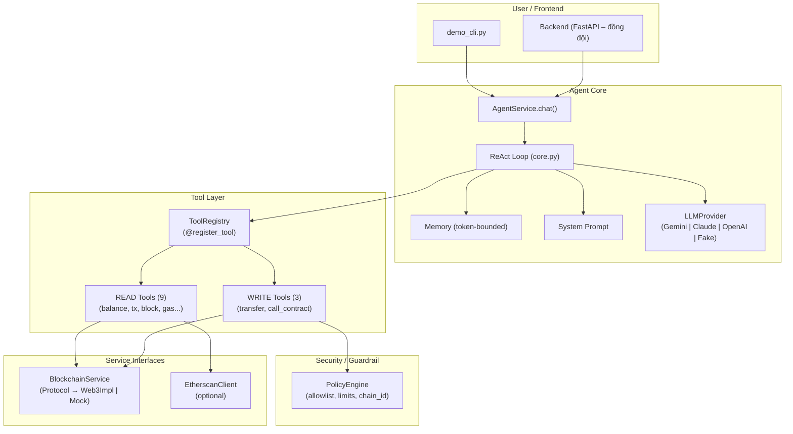

# Architecture – AI Agent with Blockchain Tools

## API composition và lifecycle hiện tại

`backend/api/server.py` giữ `create_app()` và entry point chạy API. Factory gọi
`backend/bootstrap/runtime.py` để kiểm tra profile, feature flags và lắp cấu hình;
`backend/bootstrap/lifespan.py` khởi tạo các service khi ứng dụng startup.
`backend/bootstrap/retrieval.py` chọn và kiểm tra scope RAG theo chain/deployment.
Factory và module import không kết nối RPC hoặc mở database.

| Module | Trách nhiệm |
|---|---|
| `backend/api/schemas.py` | Request models và validation |
| `backend/api/routes/` | Health/network, chat, approval và proposal endpoints |
| `backend/api/wallet_routes.py` | Xác thực ví, hội thoại và lịch sử có phân quyền |
| `backend/api/dependencies.py` | Kiểm tra quyền dùng legacy endpoints |
| `backend/api/error_handlers.py` | Chuyển lỗi wallet API thành HTTP và chính sách cache |
| `backend/bootstrap/runtime.py` | Cấu hình đã kiểm tra, chưa mở tài nguyên |
| `backend/bootstrap/lifespan.py` | Startup/shutdown, lắp service, receipt worker |

Routes lấy service từ `request.app.state`. Mỗi app có runtime riêng; public
factory vẫn hỗ trợ inject blockchain, policy, LLM, retriever và wallet settings.
LLM/retriever được truyền vào do caller quản lý. Tài nguyên do app tạo được đăng
ký vào `AsyncExitStack` ngay sau khi tạo và được đóng khi startup lỗi hoặc shutdown.
Thứ tự đóng: dừng receipt worker → database → retriever → LLM. Nếu một thao tác
cleanup lỗi, các thao tác cleanup còn lại vẫn được thực hiện.

Các phần dưới mô tả agent core và lớp công cụ ban đầu; flow wallet history và
database xem thêm `WALLET_HISTORY_RUNBOOK.md` và `WALLET_HISTORY_DATABASE_PLAN.md`.

## 1. Tổng quan



## 2. Luồng xử lý (ReAct Loop)

```
User message
    │
    ▼
AgentLoop.run(message)
    │
    ├── 1. Add user message to memory
    │
    ├── 2. Build messages (system + history)
    │
    ├── 3. LLM.chat(messages, tools)
    │       │
    │       ├── Case A: LLM returns text → FINAL answer
    │       │
    │       └── Case B: LLM returns tool_calls
    │               │
    │               ├── For each tool_call:
    │               │   ├── Lookup tool in Registry
    │               │   ├── If WRITE → log warning, delegate to tool
    │               │   ├── Validate arguments (Pydantic)
    │               │   ├── Execute tool.run(validated, ctx)
    │               │   │   └── WRITE tools: PolicyEngine checks inside
    │               │   └── Add tool result to memory
    │               │
    │               └── Loop back to step 2
    │
    └── 4. Return events list
```

## 3. Tool Layer

### BaseTool (Protocol)

```python
class BaseTool:
    name: str           # unique identifier
    description: str    # shown to LLM
    risk_level: RiskLevel  # READ or WRITE
    args_schema: BaseModel # Pydantic input schema

    async def run(self, validated, ctx: ToolContext) -> ToolResult
```

### ToolContext (Dependency Injection)

```python
@dataclass
class ToolContext:
    blockchain: BlockchainService  # RPC calls
    settings: Settings             # config
    _cache: dict                   # TTL cache
```

Mỗi tool nhận `ToolContext` – không import trực tiếp service.

### ToolRegistry

- `@register_tool` decorator → auto-register vào global registry
- `ToolRegistry(enabled_override=[...])` → filter theo `tools.yaml`
- Export schema: `to_openai_tools()`, `to_anthropic_tools()`, `to_gemini_tools()`

### Risk Levels

| Level | Behavior |
|-------|----------|
| `READ` | Chạy tự do, không cần xác nhận |
| `WRITE` | Qua PolicyEngine, cần dry_run hoặc confirm |

## 4. PolicyEngine

```
WRITE tool request
    │
    ├── check_transfer(to, value_eth)
    │   ├── Allowlist empty? → DENY (deny-by-default)
    │   ├── Address in allowlist? → DENY if not
    │   ├── Value > per_tx_limit? → DENY
    │   └── Daily total > daily_limit? → DENY
    │
    ├── check_contract_call(contract, function, value)
    │   ├── Contract allowlist empty? → DENY
    │   ├── Contract in allowlist? → DENY if not
    │   ├── Function in allowlist? → DENY if not
    │   └── Value limits check
    │
    └── check_chain_id(chain_id)
        └── chain_id != 11155111 (Sepolia)? → DENY
```

Config: `config/policy.yaml`

## 5. LLM Adapters

| Provider | Module | SDK |
|----------|--------|-----|
| Google Gemini | `agent/llm/gemini.py` | `google-genai` |
| Anthropic Claude | `agent/llm/anthropic.py` | `anthropic` |
| OpenAI | `agent/llm/openai_adapter.py` | `openai` |
| Fake (testing) | `agent/llm/fake.py` | (none) |

Tất cả implement `LLMProvider` Protocol:
```python
class LLMProvider(Protocol):
    async def chat(self, messages, tools=None) -> LLMResponse
```

## 6. Memory Management

`ConversationMemory` giữ lịch sử hội thoại trong token budget:

- **Token counting**: `TiktokenCounter` (cl100k_base) – approximate
- **Buffer**: 20% dự trù (10000 tokens → effective 8000)
- **Trimming**: Khi vượt budget, xóa messages cũ nhất (giữ system prompt)
- **Provider usage**: Nếu LLM trả `usage.total_tokens`, dùng thay tiktoken

## 7. Service Interfaces

### BlockchainService (Protocol)

```python
class BlockchainService(Protocol):
    async def get_balance(self, address: str) -> int
    async def get_token_balance(self, token, wallet) -> int
    async def get_token_info(self, token) -> dict
    async def get_transaction(self, tx_hash) -> dict | None
    async def get_block(self, identifier) -> dict
    async def get_gas_price(self) -> int
    async def estimate_gas(self, tx_params) -> int
    async def call(self, tx_params) -> bytes
    async def get_chain_id(self) -> int
    async def get_transaction_count(self, address) -> int
    async def send_raw_transaction(self, raw_tx) -> str
    async def read_contract(self, address, abi, fn, args) -> Any
```

2 implementations:
- `Web3BlockchainService` – real RPC
- `MockBlockchainService` – deterministic testing

### Retriever (Protocol)

```python
class Retriever(Protocol):
    async def search(self, query, top_k) -> list[dict]
```

Hiện tại: `NullRetriever` (trả empty). Đồng đội có thể implement RAG.

## 8. Config

| File | Mục đích |
|------|---------|
| `.env` | API keys, RPC URL, wallet key |
| `config/settings.py` | Pydantic Settings (auto-load .env) |
| `config/tools.yaml` | Enable/disable tools |
| `config/policy.yaml` | Allowlists, limits, chain ID |
| `abis/*.json` | Smart contract ABIs |

## 9. Testing Strategy

| Layer | Test file | Coverage |
|-------|-----------|----------|
| Agent loop | `test_agent_loop.py` | 88% |
| READ tools | `test_tools_read.py` | 64-95% |
| WRITE tools | `test_tools_write.py` | 51-72% |
| PolicyEngine | `test_policy.py` | 96% |
| Registry | `test_registry.py` | 65% |
| Services | `test_services.py` | Mock only |
| Eval module | `test_eval_and_coverage.py` | 85% |

Tổng: **116 tests, 85% coverage, ruff clean**.
