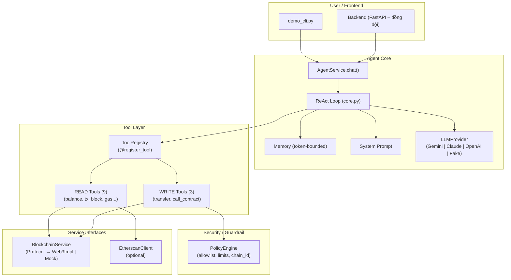

# Architecture – AI Agent with Blockchain Tools

## API composition và lifecycle hiện tại

`backend/api/server.py` giữ `create_app()` và entry point chạy API. Factory gọi
`backend/bootstrap/runtime.py` để kiểm tra profile, feature flags và lắp cấu hình;
`backend/bootstrap/lifespan.py` khởi tạo các service khi ứng dụng startup.
`backend/bootstrap/retrieval.py` chọn và kiểm tra scope RAG theo chain/deployment.
Factory và module import không kết nối RPC hoặc mở database.

| Module | Trách nhiệm |
|---|---|
| `backend/api/schemas.py` | Request models và validation |
| `backend/api/routes/` | Health/network, chat, approval và proposal endpoints |
| `backend/api/wallet_routes.py` | Xác thực ví, hội thoại và lịch sử có phân quyền |
| `backend/api/dependencies.py` | Kiểm tra quyền dùng legacy endpoints |
| `backend/api/error_handlers.py` | Chuyển lỗi wallet API thành HTTP và chính sách cache |
| `backend/bootstrap/runtime.py` | Cấu hình đã kiểm tra, chưa mở tài nguyên |
| `backend/bootstrap/lifespan.py` | Startup/shutdown, lắp service, receipt worker |

Routes lấy service từ `request.app.state`. Mỗi app có runtime riêng; public
factory vẫn hỗ trợ inject blockchain, policy, LLM, retriever và wallet settings.
LLM/retriever được truyền vào do caller quản lý. Tài nguyên do app tạo được đăng
ký vào `AsyncExitStack` ngay sau khi tạo và được đóng khi startup lỗi hoặc shutdown.
Thứ tự đóng: dừng receipt worker → database → retriever → LLM. Nếu một thao tác
cleanup lỗi, các thao tác cleanup còn lại vẫn được thực hiện.

Các phần dưới mô tả agent core và lớp công cụ ban đầu; flow wallet history và
database xem thêm `WALLET_HISTORY_RUNBOOK.md` và `WALLET_HISTORY_DATABASE_PLAN.md`.

## Frontend composition hiện tại

`frontend/app.js` lắp các view/controller và khởi động dashboard. `state.js` tạo
state cho từng dashboard; dependency được truyền vào factory thay vì view import
state toàn cục. `controllers/` quản lý chat, approval, tải assets và wallet session;
`ui/` render DOM, theme/ngôn ngữ, timeline, modal và bố cục. HTTP của dashboard đi
qua `dashboardApi` trong `api.js`; `WalletController` và `HistoryView` tiếp tục
quản lý tương tác với provider và dữ liệu lịch sử.

Controller chat kiểm tra đồng thời wallet generation, conversation và history
epoch trước khi render response. Tải số dư giữ generation guard; receipt polling
legacy chỉ gọi endpoint đọc trạng thái sau lần review đầu tiên.

`styles.css` là entry point import các file trong `styles/` theo thứ tự cascade
hiện tại. Browser có thể tải trực tiếp các ES module/CSS qua FastAPI; Vite gộp
cùng nguồn này khi build production. Các module và stylesheet vẫn được revalidate
qua `Cache-Control: no-cache` trong chế độ wallet history.

## Transaction preparation và execution hiện tại

`backend/services/transactions/` chứa các phần dùng chung:

| Module | Trách nhiệm |
|---|---|
| `models.py` | Transaction error, proposal đang chờ và kết quả chuẩn bị |
| `serialization.py` | Canonical JSON hash và chuyển receipt thành dữ liệu JSON |
| `preflight.py` | Chain rules, deployment/ABI/bytecode identity, nonce, gas, balance và `eth_call` |
| `preparation.py` | Chuẩn hóa amount/recipient, tạo unsigned transaction và đánh giá policy |
| `transports.py` | Gửi bằng tài khoản local hoặc ký/gửi raw transaction Sepolia |

`TransactionCoordinator` tiếp tục sở hữu lock, proposal binding, approval review,
nonce fence và receipt reconciliation. Nó dùng `TransactionPreparer` qua composition,
rồi gọi transport sau approval và lần preflight cuối. Import cũ của `TransactionError`,
`BoundProposal`, `SUPPORTED`, `digest` và `json_safe` từ coordinator vẫn hoạt động.

`BrowserPreparer` chỉ dùng preparation/preflight, không kế thừa coordinator và không
nhận execution transport. `BrowserWalletService` gọi `preflight()` công khai trước
khi cấp quyền ký; database tiếp tục quản lý context, version, send lock và submission.

Sepolia giữ các fixture và fee/nonce ledger hiện có. Transport ký transaction,
lưu reservation bền vững, gắn expected hash vào pending approval, rồi mới gửi raw
transaction. Không có thay đổi về thứ tự reserve-before-send hoặc xử lý `UNKNOWN`.

## Synchronous blockchain adapters

`backend/services/blockchain_service.py` giữ provider/network configuration và
public facade cho callers hiện có. Các method chuyển việc cho functions trong
`backend/services/blockchain/`:

| Module | Trách nhiệm |
|---|---|
| `abi.py` | Standard ERC-20 ABI, cùng object được re-export qua import cũ |
| `access.py` | Protocol mô tả RPC, contract và unsigned-builder capabilities |
| `reads.py` | Đọc RPC, token metadata/allowance, gas và pending receipt |
| `simulation.py` | Deployment bytecode verification và token dry-run bằng `eth_call` |
| `transaction_builder.py` | Native/ERC-20 transfer, approve và faucet payload chưa ký |
| `signer.py` | Ký bằng key được truyền trực tiếp, gửi raw transaction, đợi receipt |

Các adapter nhận dependency theo protocol và dùng `w3` public; không import ngược
facade. Builder không gọi signer hoặc broadcaster. Các helper `execute_*` cũ vẫn
điều phối prepare → sign/send → receipt qua public methods của facade. Browser
wallet và proposal tools tiếp tục dùng unsigned preparation/preflight; approval,
durable reservation và quyền gửi vẫn thuộc các flow transaction đã mô tả ở trên.

Service sync này có interface khác `services/blockchain.py`, protocol async dùng
bởi agent core; hai interface tiếp tục được giữ riêng.

## Durable browser-wallet workflows

`BrowserWalletService` là facade giữ các method API hiện có. Nó lắp các workflow
trong `backend/services/wallet/` bằng composition:

| Workflow | Trách nhiệm |
|---|---|
| `deployments.py` | Nhận diện RPC/deployment, xác minh bytecode và phát hiện Hardhat reset |
| `contexts.py` | Tạo wallet context và hàng send lock trước authorization |
| `proposals.py` | Policy theo ví, chuẩn bị proposal, đọc và từ chối proposal |
| `submissions.py` | Authorize, report, lịch sử transaction và khôi phục hash theo owner |
| `reconciliation.py` | Claim lease, đọc chain evidence, xử lý replacement/reorg và cập nhật receipt |
| `scope.py` | ContextVar dùng chung giữa history routes và proposal tools |

`backend/db/repositories/` chứa SQL của các workflow trên. Mỗi hàm repository nhận
connection đang mở từ workflow, không tạo session/engine và không tự commit. Đổi
proposal sang `AWAITING_SIGNATURE`, tạo attempt, claim send lock, tạo approval và
ghi audit cùng nằm trong một transaction; lỗi ở bất kỳ bước nào sẽ rollback toàn bộ.

Reconciliation claim lease trước khi gọi RPC, sau đó kiểm tra lại deployment và
lease trước khi ghi chain evidence. Report đến trong lúc worker đọc RPC không bị
ghi đè bằng hash cũ. Các điều kiện version, lease timeout, batch size và status
transitions giữ nguyên.

`backend/db/rows.py` và `pagination.py` chứa row materialization/keyset pagination;
`backend/wallet_values.py` chứa ID, capability hash/token và chuyển RPC scalar.
Các import cũ qua `wallet_common`, `history_service` và `browser_wallet` tiếp tục
trỏ đến cùng helper/ContextVar.

## Wallet domain errors và HTTP adapter

`backend/wallet_errors.py` định nghĩa `WalletError`, `WalletErrorKind` và `fail()`
bằng thư viện chuẩn. Lỗi nghiệp vụ chứa kind, code và message; không chứa HTTP
status hoặc phụ thuộc FastAPI. Workflow, auth, pagination và worker dùng cùng
classification. `fail()` vẫn được re-export qua `wallet_common`; callers truyền
kind như `INVALID_INPUT` hoặc `CONFLICT` thay cho số HTTP status.

`backend/api/error_handlers.py` là nơi duy nhất map kind sang HTTP status. Phản hồi
vẫn có dạng `{"detail": {"code": "...", "message": "..."}}`, kèm cache policy và
request ID như trước. Cùng code `TX_HASH` có thể map sang 400 cho input lỗi hoặc
409 cho xung đột, dựa trên kind thay vì suy luận từ code/message.

Auth phân biệt domain rejection với RPC failure khi kiểm tra loại ví; worker log
code/message và tiếp tục lịch retry 15 giây khi gặp domain error. Các lỗi validation
request của FastAPI, lỗi storage và `TransactionError` vẫn giữ adapter hiện có.

## Agent integration và guardrail boundaries

`backend/agent/models.py` chứa `AgentResponse` và `TimelineStep`; model imports không
kéo theo legacy runtime hoặc mutable policy engine. Các import qua module/package
cũ vẫn trả về cùng model class. Legacy runtime giữ orchestration trong
`agent_service.py`, dùng các helper intent, validation, reads và replies trong `legacy/`.

`ReadAgentRuntime` điều phối retrieval, session lock, context, agent loop và response:

| Module | Trách nhiệm |
|---|---|
| `read_tools.py` | Backend READ adapters và registry riêng, chỉ thêm proposal tools khi được cấu hình |
| `query_rules.py` | Chuẩn hóa query retrieval và yêu cầu làm rõ amount mơ hồ |
| `retrieval_context.py` | Tạo RAG context theo token budget của conversation |
| `prompts.py` | System prompt cho READ hoặc proposal-only mode |
| `response_mapper.py` | Timeline, provider diagnostics, authoritative RPC balances và response; bỏ thought events |

Agent integration dùng `AgentService.get_session()`, `ConversationMemory.count_tokens()`
và public `create_llm()`; provider factory nằm trong `agent/llm/factory.py`. Private
factory alias cũ tiếp tục hỗ trợ injection hook trong test/caller hiện có. History
routes gọi `ReadAgentRuntime.clear_session()` để giải phóng memory và session lock.

`backend/guardrail/models.py` chứa config/decision/approval/audit models.
`rules.py` chứa operation sets, address/amount/simulation checks, parameter hashing
và description formatting. `PolicyEngine` tiếp tục sở hữu `RLock`, normalized
whitelist, pending approvals và audit log. Các check thuần vẫn chạy trong lock của
engine; review, expiration, tamper checks, state mutation và audit không bị tách
sang owner khác. `security/policy.py` của agent core vẫn là implementation riêng.

## RAG retrieval hiện tại

`rag/retriever.py` giữ public `RAGRetriever`, factory offline, query validation,
worker executor/semaphore, deadline, cancellation, cleanup và catalog cache theo
index fingerprint. Tìm kiếm đồng bộ được chuyển sang `rag/retrieval/` với dependency
provider/store/scope/options được truyền trực tiếp:

| Module | Trách nhiệm |
|---|---|
| `contracts.py` | Immutable `SourceScope`, `RetrievalOptions` và ba loại lỗi retrieval |
| `signatures.py` | Canonical ABI type signatures, overloads và tuple/array parsing |
| `metadata.py` | Khôi phục provenance, kiểm scalar filters và stored signatures |
| `candidates.py` | Đọc candidate vectors, tính cosine thực và kiểm provenance |
| `search.py` | Scope/interface filtering, ANN, ranking, parent context và token budget |

Import các contracts/parser qua `rag.retriever` vẫn trả cùng object canonical.
Module contracts có thể được import mà không tải retriever, index hoặc model.
Timeout/cancel tiếp tục giữ slot cho đến khi native worker kết thúc; catalog chỉ
được dùng lại khi index fingerprint khớp. Query không mở rộng scope hoặc tăng giả score.

`eval/rag_eval_lock.json` khóa cả các module vừa tách và ghi `structure_revision`.
Bản khóa cũ nằm ở `eval/locks/rag_eval_pre_structure_refactor.json`; các báo cáo
dev/holdout P7 cũ tiếp tục nhận diện bằng khóa này. `eval/rag_structure_equivalence.json`
ghi kết quả đối chiếu đầy đủ 20 query dev trước/sau bằng model local đã pin; đây là
kiểm tra tương đương của refactor, không phải phép đo holdout mới.

## E2E evaluation hiện tại

`scripts/evaluate_e2e.py` giữ entry point và CLI; `eval/e2e/` chứa immutable
options/validation, protocol freeze/holdout, measured provider, case execution,
JSON/CSV reporting và runner. `eval/e2e_runtime.py` tiếp tục sở hữu Hardhat fixture,
read-only benchmark RPC, RAG view và API lifecycle; request ledger và metrics vẫn
ở các module hiện có. Regression smoke dùng các module này trực tiếp thay vì
import logic từ CLI; các helper imports cũ vẫn được re-export.

Runner giữ checkpoint sau từng case, quota stop, NOT RUN trong mẫu số, báo cáo khi
lỗi hạ tầng và cleanup runtime. Provider tiếp tục reserve request trước khi gọi
LLM, không reset ledger. Protocol hash bao gồm các module mới; khóa lịch sử vẫn
không hợp lệ cho runtime đã thay đổi. Xem `eval/E2E_README.md` để chạy và diễn giải
bằng chứng FakeLLM/latency so với phép đo model thật.

## 1. Tổng quan



## 2. Luồng xử lý (ReAct Loop)

```
User message
    │
    ▼
AgentLoop.run(message)
    │
    ├── 1. Add user message to memory
    │
    ├── 2. Build messages (system + history)
    │
    ├── 3. LLM.chat(messages, tools)
    │       │
    │       ├── Case A: LLM returns text → FINAL answer
    │       │
    │       └── Case B: LLM returns tool_calls
    │               │
    │               ├── For each tool_call:
    │               │   ├── Lookup tool in Registry
    │               │   ├── If WRITE → log warning, delegate to tool
    │               │   ├── Validate arguments (Pydantic)
    │               │   ├── Execute tool.run(validated, ctx)
    │               │   │   └── WRITE tools: PolicyEngine checks inside
    │               │   └── Add tool result to memory
    │               │
    │               └── Loop back to step 2
    │
    └── 4. Return events list
```

## 3. Tool Layer

### BaseTool (Protocol)

```python
class BaseTool:
    name: str           # unique identifier
    description: str    # shown to LLM
    risk_level: RiskLevel  # READ or WRITE
    args_schema: BaseModel # Pydantic input schema

    async def run(self, validated, ctx: ToolContext) -> ToolResult
```

### ToolContext (Dependency Injection)

```python
@dataclass
class ToolContext:
    blockchain: BlockchainService  # RPC calls
    settings: Settings             # config
    _cache: dict                   # TTL cache
```

Mỗi tool nhận `ToolContext` – không import trực tiếp service.

### ToolRegistry

- `@register_tool` decorator → auto-register vào global registry
- `ToolRegistry(enabled_override=[...])` → filter theo `tools.yaml`
- Export schema: `to_openai_tools()`, `to_anthropic_tools()`, `to_gemini_tools()`

### Risk Levels

| Level | Behavior |
|-------|----------|
| `READ` | Chạy tự do, không cần xác nhận |
| `WRITE` | Qua PolicyEngine, cần dry_run hoặc confirm |

## 4. PolicyEngine

```
WRITE tool request
    │
    ├── check_transfer(to, value_eth)
    │   ├── Allowlist empty? → DENY (deny-by-default)
    │   ├── Address in allowlist? → DENY if not
    │   ├── Value > per_tx_limit? → DENY
    │   └── Daily total > daily_limit? → DENY
    │
    ├── check_contract_call(contract, function, value)
    │   ├── Contract allowlist empty? → DENY
    │   ├── Contract in allowlist? → DENY if not
    │   ├── Function in allowlist? → DENY if not
    │   └── Value limits check
    │
    └── check_chain_id(chain_id)
        └── chain_id != 11155111 (Sepolia)? → DENY
```

Config: `config/policy.yaml`

## 5. LLM Adapters

| Provider | Module | SDK |
|----------|--------|-----|
| Google Gemini | `agent/llm/gemini.py` | `google-genai` |
| Anthropic Claude | `agent/llm/anthropic.py` | `anthropic` |
| OpenAI | `agent/llm/openai_adapter.py` | `openai` |
| Fake (testing) | `agent/llm/fake.py` | (none) |

Tất cả implement `LLMProvider` Protocol:
```python
class LLMProvider(Protocol):
    async def chat(self, messages, tools=None) -> LLMResponse
```

## 6. Memory Management

`ConversationMemory` giữ lịch sử hội thoại trong token budget:

- **Token counting**: `TiktokenCounter` (cl100k_base) – approximate
- **Buffer**: 20% dự trù (10000 tokens → effective 8000)
- **Trimming**: Khi vượt budget, xóa messages cũ nhất (giữ system prompt)
- **Provider usage**: Nếu LLM trả `usage.total_tokens`, dùng thay tiktoken

## 7. Service Interfaces

### BlockchainService (Protocol)

```python
class BlockchainService(Protocol):
    async def get_balance(self, address: str) -> int
    async def get_token_balance(self, token, wallet) -> int
    async def get_token_info(self, token) -> dict
    async def get_transaction(self, tx_hash) -> dict | None
    async def get_block(self, identifier) -> dict
    async def get_gas_price(self) -> int
    async def estimate_gas(self, tx_params) -> int
    async def call(self, tx_params) -> bytes
    async def get_chain_id(self) -> int
    async def get_transaction_count(self, address) -> int
    async def send_raw_transaction(self, raw_tx) -> str
    async def read_contract(self, address, abi, fn, args) -> Any
```

2 implementations:
- `Web3BlockchainService` – real RPC
- `MockBlockchainService` – deterministic testing

### Retriever (Protocol)

```python
class Retriever(Protocol):
    async def search(self, query, top_k) -> list[dict]
```

Hiện tại: `NullRetriever` (trả empty). Đồng đội có thể implement RAG.

## 8. Config

| File | Mục đích |
|------|---------|
| `.env` | API keys, RPC URL, wallet key |
| `config/settings.py` | Pydantic Settings (auto-load .env) |
| `config/tools.yaml` | Enable/disable tools |
| `config/policy.yaml` | Allowlists, limits, chain ID |
| `abis/*.json` | Smart contract ABIs |

## 9. Testing Strategy

| Layer | Test file | Coverage |
|-------|-----------|----------|
| Agent loop | `test_agent_loop.py` | 88% |
| READ tools | `test_tools_read.py` | 64-95% |
| WRITE tools | `test_tools_write.py` | 51-72% |
| PolicyEngine | `test_policy.py` | 96% |
| Registry | `test_registry.py` | 65% |
| Services | `test_services.py` | Mock only |
| Eval module | `test_eval_and_coverage.py` | 85% |

Tổng: **116 tests, 85% coverage, ruff clean**.
