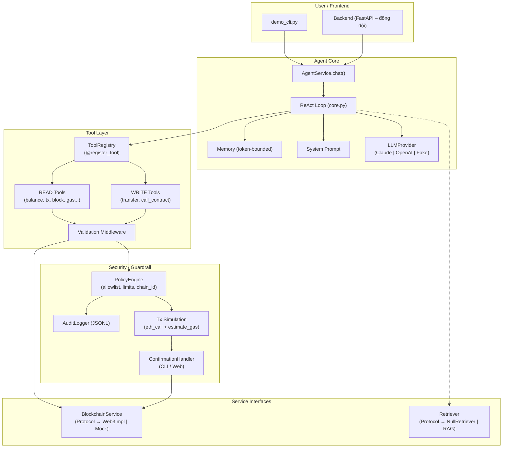
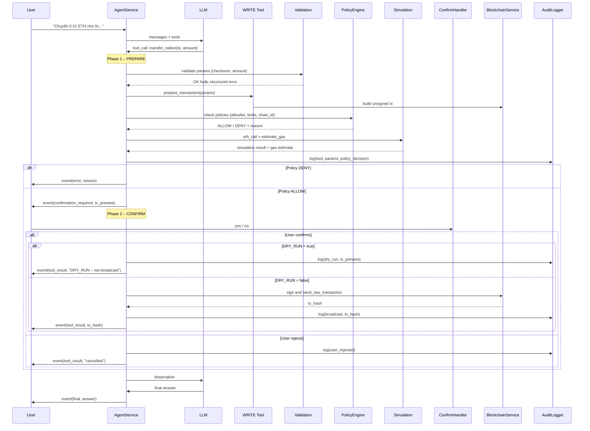

# PLAN.MD – AI Agent with Blockchain Tools

> **Phụ trách**: AI Agent core + Tool calling + Guardrail + Eval
> **Branch**: `feat/agent-core`
> **Cập nhật**: 2026-10-06

---

## 1. Tổng quan kiến trúc



---

## 2. Cấu trúc thư mục

```
ai-agent-blockchain/
├── agent/
│   ├── __init__.py
│   ├── core.py              # ReAct loop chính
│   ├── memory.py            # Conversation memory (token-bounded)
│   ├── prompts.py           # System prompt templates
│   ├── service.py           # AgentService – public API cho backend/frontend
│   └── llm/
│       ├── __init__.py
│       ├── base.py           # LLMProvider (Protocol)
│       ├── anthropic.py      # Claude adapter
│       ├── openai_adapter.py # OpenAI adapter
│       └── fake.py           # FakeLLMProvider (kịch bản test)
├── tools/
│   ├── __init__.py
│   ├── base.py              # BaseTool, ToolResult, RiskLevel
│   ├── registry.py          # @register_tool, ToolRegistry, schema generation
│   ├── read/
│   │   ├── __init__.py
│   │   ├── get_native_balance.py
│   │   ├── get_erc20_balance.py
│   │   ├── get_token_info.py
│   │   ├── get_transaction.py
│   │   ├── get_transaction_history.py
│   │   ├── get_block.py
│   │   ├── get_gas_price.py
│   │   ├── estimate_gas.py
│   │   └── read_contract.py
│   └── write/
│       ├── __init__.py
│       ├── transfer_native.py
│       ├── transfer_erc20.py
│       └── call_contract.py
├── services/
│   ├── __init__.py
│   ├── blockchain.py        # BlockchainService Protocol + Web3Implementation + Mock
│   └── retriever.py         # Retriever Protocol + NullRetriever
├── security/
│   ├── __init__.py
│   ├── policy.py            # PolicyEngine: allowlist, limits, chain_id, simulation
│   ├── confirmation.py      # ConfirmationHandler (CLI mặc định, extensible cho web)
│   ├── audit.py             # AuditLogger → JSONL
│   └── validation.py        # Validation middleware: checksum, hex, decimals, amount
├── config/
│   ├── __init__.py
│   ├── settings.py          # Pydantic Settings, đọc .env + config files
│   ├── tools.yaml           # Bật/tắt tool
│   └── policy.yaml          # Allowlist, limits, chain_id rules
├── abis/
│   └── erc20.json           # ABI ERC-20 chuẩn
├── eval/
│   ├── dataset.jsonl        # ~40 câu hỏi (VN + EN)
│   └── run_eval.py          # Chạy eval, xuất CSV/Markdown
├── tests/
│   ├── __init__.py
│   ├── conftest.py          # Fixtures chung
│   ├── test_registry.py
│   ├── test_validation.py
│   ├── test_policy.py
│   ├── test_tools_read.py
│   ├── test_tools_write.py
│   ├── test_agent_loop.py
│   └── test_guardrail_e2e.py
├── scripts/
│   └── demo_cli.py          # Demo CLI interactive
├── docs/
│   ├── PLAN.md              # (file này)
│   ├── ARCHITECTURE.md
│   ├── ADDING_A_TOOL.md
│   └── INTEGRATION.md
├── .env.example
├── .gitignore
├── pyproject.toml
└── README.md
```

---

## 3. Interfaces giao tiếp với đồng đội

### 3.1 BlockchainService (Protocol)

```python
class BlockchainService(Protocol):
    """Đồng đội blockchain có thể thay Web3Implementation bằng implementation riêng."""

    async def get_balance(self, address: str) -> int: ...
    async def get_erc20_balance(self, token_address: str, wallet_address: str) -> int: ...
    async def get_transaction(self, tx_hash: str) -> dict: ...
    async def get_block(self, block_identifier: int | str) -> dict: ...
    async def get_gas_price(self) -> int: ...
    async def estimate_gas(self, tx: dict) -> int: ...
    async def call(self, tx: dict) -> bytes: ...  # eth_call cho simulation
    async def send_raw_transaction(self, signed_tx: bytes) -> str: ...
    async def get_transaction_count(self, address: str) -> int: ...
    async def get_chain_id(self) -> int: ...
    async def read_contract(self, address: str, abi: list, function_name: str, args: list) -> Any: ...
    async def get_token_info(self, token_address: str) -> dict: ...
```

### 3.2 Retriever (Protocol)

```python
class Chunk(TypedDict):
    content: str
    metadata: dict
    score: float

class Retriever(Protocol):
    """Đồng đội RAG implement; mặc định NullRetriever trả []."""
    async def retrieve(self, query: str, k: int = 5) -> list[Chunk]: ...
```

### 3.3 LLMProvider (Protocol)

```python
class ToolCall(TypedDict):
    id: str
    name: str
    arguments: dict

class LLMResponse:
    content: str | None
    tool_calls: list[ToolCall]
    usage: dict  # prompt_tokens, completion_tokens

class LLMProvider(Protocol):
    async def chat(self, messages: list[dict], tools: list[dict] | None = None) -> LLMResponse: ...
```

### 3.4 AgentService (public API cho backend/frontend)

```python
class AgentEvent:
    type: Literal["thought", "tool_call", "tool_result",
                   "confirmation_required", "final", "error"]
    data: dict
    timestamp: datetime

class AgentService:
    async def chat(self, session_id: str, message: str) -> AgentEvent:
        """Sync: trả event cuối cùng (final)."""

    async def chat_stream(self, session_id: str, message: str) -> AsyncIterator[AgentEvent]:
        """Async stream: yield từng event để UI hiển thị real-time."""

    async def confirm(self, session_id: str, confirmed: bool) -> AgentEvent:
        """User xác nhận/từ chối một pending transaction."""
```

### 3.5 ConfirmationHandler (extensible)

```python
class ConfirmationHandler(Protocol):
    async def request_confirmation(self, tx_preview: dict) -> bool: ...
```

- Mặc định: `CLIConfirmationHandler` (input yes/no).
- Đồng đội backend/frontend: implement handler riêng.

---

## 4. Danh sách Tool

| Tool | Risk | Mô tả |
|------|------|--------|
| `get_native_balance` | READ | Lấy số dư ETH (Sepolia) của một địa chỉ |
| `get_erc20_balance` | READ | Lấy số dư token ERC-20 |
| `get_token_info` | READ | name, symbol, decimals, totalSupply |
| `get_transaction` | READ | Chi tiết giao dịch theo tx hash |
| `get_transaction_history` | READ | Lịch sử giao dịch (Etherscan API, free tier) |
| `get_block` | READ | Thông tin block |
| `get_gas_price` | READ | Gas price hiện tại |
| `estimate_gas` | READ | Ước tính gas cho giao dịch |
| `read_contract` | READ | Gọi hàm view/pure trên contract |
| `transfer_native` | WRITE | Chuyển ETH Sepolia |
| `transfer_erc20` | WRITE | Chuyển token ERC-20 |
| `call_contract` | WRITE | Gọi hàm state-changing trên contract |

### Giới hạn `get_transaction_history`
- Etherscan Sepolia API (free tier): tối đa 5 req/s, tối đa 10.000 records.
- Cần `ETHERSCAN_API_KEY` trong `.env`.
- Không có key → trả lỗi rõ ràng.

---

## 5. Luồng xử lý WRITE tool (2 pha)



---

## 6. Cấu hình & Bảo mật

### `.env.example`
```env
# LLM Provider
LLM_PROVIDER=anthropic          # anthropic | openai | fake
ANTHROPIC_API_KEY=sk-ant-...
OPENAI_API_KEY=sk-...
LLM_MODEL=                      # Để trống → dùng default

# Blockchain
SEPOLIA_RPC_URL=https://rpc.sepolia.org
WALLET_PRIVATE_KEY=0x...        # Ví TESTNET only!
ETHERSCAN_API_KEY=               # Optional, cho get_transaction_history

# Security
DRY_RUN=true                    # Mặc định true
MAX_STEPS=10
```

### `config/policy.yaml`
```yaml
chain_id: 11155111  # Sepolia only

allowlist:
  addresses: []      # Rỗng = cho phép tất cả (demo)
  contracts: []
  functions: []

limits:
  per_transaction_eth: "0.1"
  daily_eth: "0.5"

require_simulation: true
block_on_revert: true
```

---

## 7. Giả định (cần xác nhận)

| # | Giả định | Hậu quả nếu sai |
|---|----------|-----------------|
| A1 | Chưa có smart contract deploy → dùng ABI ERC-20 chuẩn | Cập nhật `abis/` khi đồng đội deploy |
| A2 | `call_contract` hỗ trợ `deposit()` + `withdraw(uint256)` | Cần đồng đội xác nhận ABI |
| A3 | `get_transaction_history` dùng Etherscan Sepolia API | Đồng đội có nguồn khác thì thay qua `BlockchainService` |
| A4 | Private key trong `.env` là ví testnet chuyên dụng | `DRY_RUN=true` luôn chặn nếu vi phạm |
| A5 | Python 3.11+ | Dùng `match/case`, `StrEnum`, typing mới |
| A6 | `allowlist.addresses: []` = cho phép tất cả | Có thể đổi: rỗng = chặn tất cả. **Cần xác nhận.** |

---

## 8. Rủi ro & Giải pháp

| Rủi ro | Giải pháp |
|--------|-----------|
| LLM sinh sai hex/checksum | Validation middleware + EIP-55 check; structured error cho LLM tự sửa |
| Latency cao | Timeout 30s LLM, 10s RPC; retry ≤ 2; cache TTL 60s (chain_id, decimals, gas) |
| Prompt injection từ on-chain | Data đánh dấu `[UNTRUSTED]`; system prompt cấm policy override |
| Private key leak | Chỉ đọc env var; không log; không đưa vào prompt |
| Vượt hạn mức / sai chain | Policy check chain_id + per-tx + daily limit trước confirm |
| Tool crash | Try/catch → `ToolResult(ok=False, error=...)` |
| Rate limit Etherscan | Exponential backoff; ghi rõ giới hạn |

---

## 9. Dependencies

```
# Runtime
web3>=7.0,<8.0
pydantic>=2.0,<3.0
pydantic-settings>=2.0
anthropic>=0.40
openai>=1.50
python-dotenv>=1.0
pyyaml>=6.0
tiktoken>=0.8

# Dev
pytest>=8.0
pytest-asyncio>=0.24
ruff>=0.8
```

---

## 10. Milestones

### M1 – Khung + Registry + Interfaces
- [ ] `pyproject.toml`, `.env.example`, config files
- [ ] `tools/base.py`, `tools/registry.py`
- [ ] `services/blockchain.py` (Protocol + Web3Impl + Mock)
- [ ] `services/retriever.py` (Protocol + NullRetriever)
- [ ] `agent/llm/base.py` (Protocol)
- [ ] `config/settings.py`
- [ ] `abis/erc20.json`
- [ ] Unit test: registry, schema generation
- **Gate**: `pytest` pass, `ruff` pass

### M2 – Tool READ + Agent Loop + CLI
- [ ] Tất cả READ tools
- [ ] LLM adapters (Anthropic, OpenAI, Fake)
- [ ] `agent/core.py`, `memory.py`, `prompts.py`, `service.py`
- [ ] `scripts/demo_cli.py`
- [ ] Test agent loop với FakeLLMProvider
- **Gate**: CLI chạy được, READ tools pass trên MockBlockchainService

### M3 – Validation + Guardrail + Tool WRITE
- [ ] `security/validation.py`, `policy.py`, `confirmation.py`, `audit.py`
- [ ] WRITE tools
- [ ] Test: checksum sai, vượt hạn mức, ngoài allowlist, revert, user reject, injection
- **Gate**: WRITE flow prepare→policy→confirm→dry_run, audit log đúng

### M4 – Eval + Test hoàn chỉnh
- [ ] `eval/dataset.jsonl` ~40 câu
- [ ] `eval/run_eval.py`
- [ ] Coverage ≥ 80%
- **Gate**: eval xuất CSV/MD

### M5 – Docs + Integration
- [ ] README.md hoàn chỉnh
- [ ] `docs/ARCHITECTURE.md`, `ADDING_A_TOOL.md`, `INTEGRATION.md`
- **Gate**: đồng đội đọc hiểu được

---

## 11. Câu hỏi cần xác nhận

1. **A6**: `allowlist.addresses: []` = "cho phép tất cả" hay "chặn tất cả"?
   → Đề xuất: cho phép tất cả (tiện demo), log warning.
2. **Contract mẫu**: đồng đội deploy contract nào? ABI + function signatures?
   → Tạm dùng ERC-20 chuẩn.
3. **Etherscan API key**: có key Sepolia không?
4. **Token counting**: dùng `tiktoken` cho cả Claude + OpenAI có ổn?
