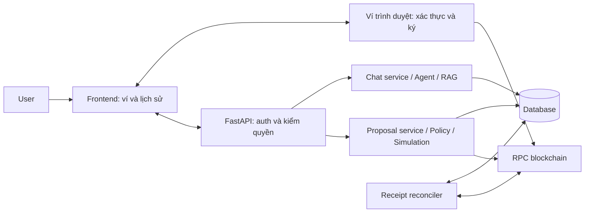

# Kế hoạch đổi ví và lưu lịch sử bằng database

Ngày lập: 28/10/2026. Trạng thái: đã triển khai bản SQLite một instance; các phần mở rộng được ghi riêng bên dưới.

Tiến độ triển khai 28/10/2026: bản SQLite một instance đã được hiện thực; xem
[runbook](WALLET_HISTORY_RUNBOOK.md) để chạy migration, kết nối/đổi ví và kiểm thử.
Phần PostgreSQL nhiều instance, WalletConnect, contract wallet và gộp identity nhiều ví
vẫn thuộc giai đoạn mở rộng. Nhận diện reset local dùng `hardhat_metadata.instanceId`
kết hợp fingerprint deployment thay vì chỉ dựa manifest/chain ID.

## 1. Kết quả cần đạt và phạm vi

- User kết nối ví trình duyệt, chuyển A → B → A mà không sửa `.env` hoặc restart API.
- Ví A và B có lịch sử chat, đề xuất, giao dịch riêng; chỉ chủ ví đã xác thực được đọc lịch sử riêng.
- Reload trang hoặc restart API vẫn đọc được lịch sử; các giao dịch đã gửi tiếp tục được đối soát.
- Agent chỉ chuẩn bị đề xuất. User duyệt trong app rồi ký/gửi bằng ví trình duyệt.
- Không đưa private key/seed phrase vào frontend app, backend, database, log hoặc LLM.
- Giữ các giới hạn policy, whitelist, mô phỏng và ràng buộc payload hiện có.

Giả định cho phiên bản đầu:

- Mỗi địa chỉ EOA là một chủ thể riêng. Không tự coi A và B là cùng một người dù cùng extension.
- Hardhat local và Sepolia là mạng hỗ trợ; mỗi runtime vẫn dùng chain được cấu hình, không đổi mạng RPC toàn server theo một user.
- Một browser profile có một phiên đăng nhập ví hoạt động. Đổi ví đăng nhập sẽ đồng bộ các tab; muốn đồng thời hai ví dùng hai browser profile.
- Lưu lịch sử phát sinh qua app, không lập index toàn bộ giao dịch on-chain của ví.
- Chỉ ba operation đang có: native transfer, ERC-20 transfer, faucet claim. Không mở generic contract call/allowance/owner operation.
- Chưa gồm WalletConnect/mobile, smart-contract wallet/ERC-1271, liên kết nhiều ví vào một tài khoản hay quản trị user. UI trả lỗi rõ ràng cho loại ví chưa hỗ trợ.
- Không có yêu cầu tự động ký, tự động gửi hoặc cấp quyền gửi Sepolia mới trong kế hoạch này.

## 2. Hiện trạng đã kiểm tra trong repository

| Thành phần | Hiện tại | Khoảng trống cần xử lý |
| --- | --- | --- |
| `frontend/app.js` | `state.wallet`, UUID phiên trong tab, gọi `/api/wallet/info` không truyền địa chỉ | Chưa kết nối provider; reload mất phiên; refresh có thể đưa về ví demo |
| `backend/api/server.py` | Chọn ví mặc định qua `DEMO_WALLET_ADDRESS`; chat nhận `wallet_address` và `session_id` | Hai trường do client gửi không xác thực chủ ví; chưa có API lịch sử |
| `agent/service.py` | `_sessions` chứa `ConversationMemory` trong RAM | Không khôi phục hội thoại sau restart; cần lưu trước khi memory bị trim |
| `agent/memory.py` | Trim theo trọn lượt chat và token budget | Giữ nguyên nguyên tắc này khi tái dựng context từ DB |
| `backend/services/transaction_coordinator.py` | Một sender cố định, `_proposals`, lock và uncertain nonce trong RAM | Chưa hỗ trợ user ký bằng nhiều ví; restart mất trạng thái đối soát |
| `backend/guardrail/policy_engine.py` | Pending approval/audit nằm trong RAM | Cần persistence và chuyển trạng thái nguyên tử |
| `backend/services/sepolia_execution.py` | Signer backend và file ledger cho một grant giới hạn | Không dùng làm cơ chế đa user; giữ ledger/grant cũ nguyên trạng |

Không thể khôi phục đầy đủ chat/approval cũ đã mất khỏi RAM. Dữ liệu lưu bền bắt đầu từ khi tính năng mới được bật; không dựng lịch sử giả từ số dư hoặc hash rời rạc.

## 3. Kiến trúc và lựa chọn database



Lựa chọn mặc định cho đồ án: SQLite file tại `data/app.db`, SQLAlchemy làm lớp truy cập dữ liệu, Alembic quản lý migration. SQLite phù hợp một API instance và lượng ghi nhỏ; khi triển khai nhiều instance hoặc ghi đồng thời cao, dùng PostgreSQL và kiểm thử concurrency trên PostgreSQL trước khi bật.

- Cấu hình qua `DATABASE_URL` trong `.env` root; không tạo `.env` trong thư mục con.
- Khóa phiên bản dependency tương thích với Python/Web3/FastAPI hiện có; cập nhật input, constraints và lockfile theo quy trình dependency của repo. Không mặc định lấy bản mới nhất.
- SQLAlchemy session có vòng đời theo một đơn vị công việc; không chia sẻ session giữa thread/task.
- Không giữ DB transaction/lock trong khi đợi LLM, RPC hoặc cửa sổ ký của ví.
- SQLite bật foreign keys, WAL trên ổ đĩa local và busy timeout có giới hạn. Giao dịch DB ngắn; không đặt file trên network share.
- DB là nguồn chuẩn cho dữ liệu ứng dụng. RPC/receipt là nguồn chuẩn cho kết quả blockchain.
- Cache RAM chỉ phục vụ tốc độ, có giới hạn dung lượng/TTL và có thể bỏ mà không mất lịch sử.
- File DB, `-wal`, `-shm`, bản backup và secret phải được ignore; không commit vào Git.

Nguồn thiết kế: [SQLite: Appropriate Uses](https://www.sqlite.org/whentouse.html), [SQLAlchemy Session Basics](https://docs.sqlalchemy.org/en/21/orm/session_basics.html), [Alembic Tutorial](https://alembic.sqlalchemy.org/en/latest/tutorial.html). Đây là lựa chọn kiến trúc cho phạm vi đồ án, không phải cam kết đổi `DATABASE_URL` là đủ để chuyển DB.

## 4. Mô hình dữ liệu đề xuất

Các ID là UUID opaque; timestamp lưu UTC và hiển thị theo múi giờ client. Địa chỉ có dạng canonical để so sánh, dạng checksum để hiển thị. Chain ID là metadata riêng, không gộp hai mạng vào một lịch sử giao dịch.

| Bảng | Trường chính | Ràng buộc / mục đích |
| --- | --- | --- |
| `wallet_identities` | `id`, `address_normalized`, `address_checksum`, `created_at`, `last_seen_at` | Unique địa chỉ EOA; một ví là một chủ thể |
| `auth_challenges` | `id`, `nonce_hash`, `message`, `address`, `chain_id`, `domain`, `uri`, `browser_binding_hash`, `expires_at`, `consumed_at` | Nonce ngẫu nhiên, dùng một lần; ràng buộc browser đang đăng nhập |
| `auth_sessions` | `id`, `wallet_id`, `token_hash`, `expires_at`, `revoked_at`, `created_at` | Chỉ lưu hash token; session ràng buộc bất biến với một ví |
| `wallet_contexts` | `id`, `auth_session_id`, `chain_id`, `deployment_id`, `generation`, `revoked_at` | Phiên thao tác của tab; generation phát hiện request cũ |
| `chain_deployments` | `id`, `chain_id`, `instance_id`, `contract_address`, `deployment_block_hash`, `abi_hash`, `runtime_hash`, `active` | Phân biệt reset Hardhat và deployment mới dù chain ID không đổi |
| `conversations` | `id`, `wallet_id`, `chain_id`, `deployment_id`, `title`, `created_at`, `updated_at`, `archived_at` | Chủ ví không thay đổi; chain/deployment của hội thoại không đổi |
| `chat_turns` | `id`, `conversation_id`, `client_request_id`, `status`, `started_at`, `finished_at`, `lease_until`, `error_code` | Unique `(conversation_id, client_request_id)`; chống ghi trùng khi retry |
| `messages` | `id`, `turn_id`, `sequence`, `role`, `content`, `tool_calls_json`, `tool_call_id`, `metadata_json` | Unique `(turn_id, sequence)`; giữ đủ cặp tool-call/result cần cho context |
| `proposals` | `id`, `wallet_id`, `conversation_id`, `turn_id`, `context_id`, `context_generation`, `chain_id`, `deployment_id`, `operation`, `sender`, `recipient`, `token`, `amount_raw`, `parameters_json`, `transaction_json`, `parameter_hash`, `payload_hash`, `policy_version`, `status`, `expires_at`, `version` | Payload bất biến sau khi tạo; cập nhật trạng thái dùng điều kiện version/status |
| `approval_events` | `id`, `proposal_id`, `auth_session_id`, `action`, `parameter_hash`, `created_at`, `reason` | Lịch sử duyệt/từ chối; không sửa đè sự kiện |
| `transaction_attempts` | `id`, `proposal_id`, `submission_id`, `expected_nonce`, `tx_hash`, `status`, `verification_status`, `replaces_attempt_id`, `last_checked_at`, `next_check_at`, `lease_until` | Một proposal có thể có các attempt/replacement; unique submission ID và hash trong deployment |
| `transaction_receipts` | `attempt_id`, `block_number`, `block_hash`, `receipt_status`, `gas_used`, `effective_gas_price`, `confirmations`, `receipt_json`, `finalized_at` | Receipt chỉ do backend lấy từ RPC; cập nhật khi reorg |
| `audit_events` | `id`, `wallet_id`, `proposal_id`, `request_id`, `event_type`, `sanitized_data`, `created_at` | API chỉ thêm/đọc; audit không đồng nghĩa chống sửa bởi người quản trị DB |

Quy tắc lưu:

- `amount_raw`, `value`, gas fee và uint256 lưu chuỗi số nguyên thập phân được validate; không dùng float hoặc SQL BIGINT cho uint256. API cũng trả số lớn dạng chuỗi.
- Nội dung giao dịch lưu snapshot để so sánh; `status` có CHECK constraint hoặc enum nhất quán giữa ORM/API.
- Index theo `(wallet_id, updated_at, id)` cho hội thoại, `(conversation_id, turn/order)` cho tin nhắn, `(wallet_id, chain_id, created_at, id)` cho proposal, `(status, next_check_at)` cho đối soát.
- Foreign key đảm bảo quan hệ; service kiểm owner/chain/deployment nhất quán khi ghi. ID khó đoán không thay cho kiểm quyền.
- Không đặt unique `(sender, nonce)` trên mọi attempt: replacement có thể dùng cùng nonce. Khóa phiên gửi đang hoạt động theo ví/chain/deployment và liên kết attempt thay thế rõ ràng.
- Không lưu API key, raw session token, private key, seed phrase hoặc chữ ký giao dịch thô vào bảng chat/audit. Chữ ký đăng nhập chỉ xử lý để verify, không log.

## 5. Đăng nhập và bảo vệ lịch sử riêng

Kết nối provider cho phép đọc địa chỉ; để truy cập lịch sử riêng phải chứng minh quyền sở hữu bằng chữ ký đăng nhập theo [ERC-4361 / SIWE](https://eips.ethereum.org/EIPS/eip-4361).

Luồng:

1. User chọn provider/tài khoản, frontend đọc account và chain.
2. `POST /api/auth/challenge`: server tạo message với domain, URI, address, chain, nonce, issued-at và expiry; challenge gắn với browser bằng cookie tạm.
3. Ví hiển thị message để user ký. UI ghi rõ đây là đăng nhập, không phải chuyển tài sản.
4. `POST /api/auth/verify`: server kiểm chữ ký và toàn bộ trường đã phát hành; consume nonce nguyên tử để chặn hai verify đồng thời.
5. Server tạo session và cookie opaque `HttpOnly`, `SameSite`, `Secure` trên HTTPS; cấu hình local HTTP chỉ dành cho development.
6. Thu hồi session cũ của browser trong cùng bước commit chuyển đăng nhập; vô hiệu hóa context và proposal chưa gửi của session đó. Không đăng xuất thiết bị khác của cùng ví.
7. `GET /api/auth/me` trả identity đã xác thực. Frontend mới tải lịch sử riêng của ví đó.

Chi tiết bắt buộc:

- API có tác động trạng thái kiểm Origin/CSRF; CORS chỉ các origin cấu hình. Challenge/verify có rate limit và expiry ngắn; giới hạn tài nguyên áp dụng trước lẫn sau auth.
- Cookie đăng nhập không lưu trong localStorage. Client chỉ giữ provider preference/theme và metadata không nhạy cảm nếu cần.
- Chủ ví từ session server là nguồn kiểm quyền. `wallet_address` client gửi chỉ được bỏ qua hoặc kiểm khớp, không dùng để chọn owner tùy ý.
- Mọi endpoint lịch sử, chat, proposal, receipt và audit đều lọc theo owner; trả 404 cho tài nguyên không thuộc ví hiện tại.
- Đăng nhập lại A khôi phục quyền xem chat A. Không tự chuyển hội thoại A sang B hoặc tự nối danh tính hai ví.
- Reload: đọc `/auth/me`, kiểm provider vẫn ở account/chain phù hợp. Nếu ví đang khóa hoặc mismatch, khóa WRITE và yêu cầu kết nối/xác thực lại trước khi tiếp tục.
- Dừng auth/challenge thất bại giữa lúc đổi ví: không hiện dữ liệu A dưới nhãn B; cho retry, quay lại A hoặc disconnect rõ ràng.

## 6. Luồng đổi ví A → B

Provider adapter dùng [EIP-1193](https://eips.ethereum.org/EIPS/eip-1193) cho request/events và [EIP-6963](https://eips.ethereum.org/EIPS/eip-6963) để phát hiện nhiều extension. Có fallback provider cũ; không giả định mọi extension có cùng UI chọn tài khoản.

1. Nhận thao tác đổi ví hoặc sự kiện `accountsChanged`/`chainChanged`.
2. Tăng local generation; đặt trạng thái `SWITCHING`; khóa gửi chat/duyệt/ký. Abort fetch cũ và xóa dữ liệu riêng đang hiển thị.
3. Thu hồi context A ở server, cancel proposal chưa gửi thuộc context; nếu offline thì vẫn khóa cục bộ, hoàn tất revoke trước khi tiếp tục. TTL bảo vệ trường hợp client không quay lại.
4. Nếu một RPC ký đang mở, coi đó là attempt chưa rõ kết quả. Không giả định đóng modal hay abort fetch hủy được popup ví hoặc giao dịch.
5. Kiểm provider/account/chain B. Nếu chain không thuộc runtime, yêu cầu chuyển về mạng hỗ trợ hoặc giữ WRITE bị khóa; không đổi network manager chung của server.
6. Xác thực B theo SIWE nếu session hiện tại không khớp. Khi verify thành công, server thu hồi session cũ trong browser và tạo context B.
7. Xóa pending approval trong UI; tải số dư B với địa chỉ cụ thể; tải danh sách hội thoại B. Có thể mở chat gần nhất hoặc tạo chat mới.
8. Chỉ apply response có wallet/context/generation/conversation khớp state mới. Áp dụng cả success/error/finally để response A không bật nút sai trạng thái ở B.
9. BroadcastChannel thông báo các tab cùng browser đã đổi identity; các tab đọc lại `/auth/me`, xóa view cũ và yêu cầu kết nối nếu provider không khớp.
10. Chuyển B → A: đọc lại lịch sử A từ DB; proposal A đã cancel không được tự hồi sinh.

`accountsChanged([])` nghĩa là app không còn tài khoản được cấp quyền: khóa WRITE và dọn view riêng. Sự kiện provider disconnect do mất kết nối RPC cần hiển thị trạng thái mạng; không coi đó là bằng chứng user đã logout. Nút Disconnect của app thu hồi session/context và xóa view; không cam kết gỡ quyền extension nếu provider không hỗ trợ.

Giao dịch của A đã broadcast tiếp tục được worker theo dõi sau khi A logout; không phụ thuộc cookie của tab. B không được đọc dữ liệu riêng của A qua API.

## 7. Luồng ghi và khôi phục chat

1. User tạo/chọn conversation thuộc ví đã xác thực. Conversation ID do server cấp, tách biệt auth session và context ID.
2. Request gửi `conversation_id`, `context_id`, generation và `client_request_id`. Server kiểm owner và chain/deployment.
3. DB transaction ngắn tạo turn `PROCESSING`, lưu user message và chiếm lease theo conversation. Retry cùng ID trả trạng thái/kết quả đã có.
4. Load các turn hoàn tất gần nhất vào `ConversationMemory` trong token budget; giữ nguyên nhóm tool-call/result. Tạo system prompt/RAG context mới theo runtime, không replay tool để phục hồi memory.
5. Chạy Agent bên ngoài transaction DB. Ghi các event cần thiết và đề xuất với liên kết turn; response/timeline được chuẩn hóa, không lưu chain-of-thought hay log nội bộ nhạy cảm.
6. Khi kết thúc, commit assistant reply và trạng thái `COMPLETED`. Lỗi có mã `FAILED`; API chết giữa chừng để worker đánh dấu `INTERRUPTED` khi lease hết hạn.
7. Ghi archive đầy đủ trước khi trim cache memory. UI đọc lịch sử bằng cursor; không gửi toàn bộ lịch sử vào model.
8. Reload/restart tái dựng context từ các turn hoàn tất. Turn dở hiển thị rõ; không tự chạy lại tool có tác động hoặc gửi lại proposal/giao dịch.

Nhiều request cùng một conversation phải serialize bằng lease/conditional DB update, không chỉ `asyncio.Lock` trong RAM. Conversation khác có thể xử lý song song; giới hạn request/token theo chủ ví và browser/IP ở mức phù hợp demo.

Xóa ở MVP là archive conversation. Tin nhắn vẫn nằm trong DB theo chính sách lưu; chưa tuyên bố xóa vĩnh viễn. Chức năng purge/export riêng, retention và xử lý backup là giai đoạn sau nếu cần.

## 8. Proposal, duyệt và ký giao dịch

Không thay sender toàn cục khi một user đổi ví. Tách logic kiểm tra dùng chung khỏi transport gửi:

- `DemoLocalExecutor`: adapter hiện có, chỉ profile demo local, giữ kiểm tra unlocked Hardhat.
- `BrowserWalletCoordinator`: chuẩn bị/kiểm tra proposal và xác minh giao dịch user gửi; không có khóa ký.
- Sepolia grant/ledger cũ giữ nguyên; luồng browser mới có flag riêng, mặc định tắt WRITE cho đến khi rollout được kiểm thử.

Luồng browser:

1. Agent đề xuất operation trong whitelist công cụ.
2. Server lấy sender từ auth session, kiểm deployment/policy/balance/gas/nonce và mô phỏng bằng sender đó. Không còn yêu cầu sender nằm trong `eth_accounts` ở transport browser.
3. Lưu proposal `PENDING_REVIEW` với payload bất biến, hash, owner, context/generation, policy version và expiry. Chỉ trả approval cho UI sau khi commit thành công.
4. User xem ví gửi, recipient thực của token, số tiền, mạng, contract, phí tối đa và kết quả mô phỏng rồi duyệt.
5. Endpoint authorize kiểm lại owner/context/expiry/payload và policy; đọc lại nonce/gas. Nếu thay đổi vượt snapshot cho phép, yêu cầu tạo proposal mới và duyệt lại.
6. Conditional update `PENDING_REVIEW → AWAITING_SIGNATURE`, tạo `submission_id` trước khi mở popup ví. Duplicate approve trả attempt đã có, không tạo lệnh gửi thứ hai.
7. Frontend đọc lại provider account/chain ngay trước khi gọi ví. Gửi đúng transaction đã cấp; xử lý số nguyên bằng chuỗi hex/BigInt khi cần.
8. User ký và ví broadcast. Ví trả hash; frontend ghi pending submission có giới hạn vào sessionStorage để báo lại sau reload, không lưu payload/secret. Metadata cục bộ không cấp quyền đọc lịch sử.
9. Frontend báo hash với `submission_id`; server tự truy vấn RPC và đối chiếu from/to/value/data/chain/nonce và giới hạn phí trước khi gắn kết quả hợp lệ.
10. Worker lấy receipt; phân biệt mined success/revert, confirmations và finality; cập nhật UI và số dư.

Giới hạn cần thể hiện đúng: user tự giữ khóa có thể gửi giao dịch bên ngoài app hoặc chỉnh tham số trong ví. Guardrail kiểm soát đề xuất do app cấp; không thể thu hồi một giao dịch đã ký/broadcast. Nếu giao dịch thực tế khác payload hoặc vượt giới hạn, lưu `MISMATCHED`, audit và không báo proposal đã thực thi hợp lệ, dù giao dịch đó có thể đã xảy ra on-chain. Muốn cưỡng chế policy với mọi giao dịch của ví phải có smart account/contract riêng, ngoài phạm vi này.

Faucet có recipient chính sender. Giữ whitelist hiện tại; không tự thêm mọi địa chỉ mới vào whitelist chuyển tiền chỉ vì user kết nối ví.

## 9. Máy trạng thái và xử lý sự cố

Proposal:

```text
PENDING_REVIEW → REJECTED | EXPIRED | CANCELLED | AWAITING_SIGNATURE
AWAITING_SIGNATURE → SUBMITTED | SIGNATURE_REJECTED | UNKNOWN | MISMATCHED
```

Khi cancel proposal đã mở popup ký, attempt vẫn phải được theo dõi như có thể đã gửi; một hash đến muộn không được bỏ mất. Ghi nhận giao dịch A dưới owner A từ submission đã cấp, không gắn vào B. Endpoint báo hash đến muộn dùng capability scope hẹp, thời hạn ngắn, chỉ nhận hash, không cho đọc lịch sử hay cấp quyền ký; vẫn xác minh RPC.

Transaction attempt:

```text
UNKNOWN → SUBMITTED → MINED_SUCCESS | MINED_REVERTED → FINALIZED
SUBMITTED → REPLACED | DROPPED (chỉ khi có bằng chứng đủ)
MINED_* → SUBMITTED / UNKNOWN (khi block bị reorg)
```

`verification_status = UNVERIFIED | MATCHED | MISMATCHED` tách khỏi trạng thái mined. Finalized receipt vẫn giữ `receipt_status` success/revert; không coi mọi FINALIZED là giao dịch thành công.

| Tình huống | Cách xử lý |
| --- | --- |
| User từ chối ký | Lưu từ chối nếu chắc chắn chưa gửi; không tự mở popup lại |
| User đổi ví khi đang chờ duyệt | Cancel ở DB, chặn authorize cũ |
| User đổi ví lúc popup ký còn mở | Khóa UI mới; theo dõi attempt A và hash đến muộn; không hứa hủy được popup |
| API chết sau khi cấp lệnh ký | DB còn attempt; không tự yêu cầu ký lại; truy vấn trạng thái khi user quay lại |
| Ví gửi thành công nhưng app không nhận hash | `UNKNOWN`; tìm theo sender/nonce trong phạm vi block có giới hạn hoặc cho user cung cấp hash; không tự gửi lại |
| Hash chưa xuất hiện ở RPC | Giữ chờ với backoff; không kết luận failed chỉ vì một RPC chưa thấy |
| Retry approve hoặc báo hash | Idempotent theo proposal/submission/hash, cập nhật một bản ghi |
| DB lỗi trước authorize | Không cấp payload ký |
| DB lỗi sau broadcast | Giữ hash phía client nếu có; sau phục hồi worker đối soát; không yêu cầu gửi lại |
| Nonce đã dùng / user speed-up hoặc cancel trong ví | Theo dõi replacement; đối chiếu nội dung, không coi nonce đã tăng là bằng chứng đúng proposal |
| Restart API | Thu hồi lease hết hạn, khôi phục pending/unknown, không broadcast tự động |
| Reset Hardhat | Đánh dấu deployment cũ inactive; giữ lịch sử, chặn proposal cũ, không gộp tx hash cũ vào chain mới |

Database và blockchain không thể commit nguyên tử cùng nhau. Mục tiêu là idempotency và đối soát; không cam kết exactly-once broadcast qua ví trình duyệt.

Worker bản đầu chạy có kiểm soát trong một API instance, dùng DB lease để tránh hai worker xử lý trùng. RPC có timeout/backoff; mạng lỗi không đẩy tất cả giao dịch sang failed. Khi triển khai nhiều instance, chuyển worker riêng và kiểm nghiệm lease/locking trên PostgreSQL.

`chain_deployments.instance_id` cho local phải do setup quản lý và đổi khi tạo deployment/node epoch mới, kết hợp deployment block/hash và kiểm tra marker trên chain. Không chỉ dựa chain ID hoặc genesis hash để phát hiện mọi reset, vì fixture có thể được tái tạo giống nhau.

## 10. API dự kiến

Tên có thể điều chỉnh khi triển khai; quyền và hợp đồng dữ liệu dưới đây là bắt buộc. Dùng namespace mới để không đổi ngầm hành vi `/api/approval/action` hiện có.

| API | Mục đích / kiểm tra |
| --- | --- |
| `POST /api/auth/challenge` | Tạo challenge, browser binding, rate limit |
| `POST /api/auth/verify` | Verify SIWE; consume nonce; cấp/rotate cookie session |
| `GET /api/auth/me` | Ví đăng nhập và expiry |
| `POST /api/auth/logout` | Thu hồi session và các context/proposal chưa gửi |
| `POST /api/wallet-contexts` | Tạo context cho ví auth và chain/deployment hợp lệ |
| `POST /api/wallet-contexts/{id}/revoke` | Vô hiệu hóa context và proposal chưa gửi |
| `GET /api/wallet/info?address=...` | Số dư công khai; frontend luôn truyền account đang chọn |
| `GET /api/history/conversations?cursor=...` | Danh sách của owner; lọc chain/deployment |
| `POST /api/history/conversations` | Tạo conversation từ identity server |
| `GET /api/history/conversations/{id}/messages?cursor=...` | Tin nhắn owner, phân trang ổn định |
| `PATCH /api/history/conversations/{id}` | Đổi tên/archive, không thay owner |
| `POST /api/history/conversations/{id}/turns` | Chat mới, context/generation/request ID |
| `GET /api/history/turns/{id}` | Lấy kết quả khi request trước timeout/reload |
| `POST /api/wallet-proposals` | Chuẩn bị proposal, dùng chung service với tool Agent |
| `POST /api/wallet-proposals/{id}/reject` | Từ chối atomically |
| `POST /api/wallet-proposals/{id}/authorize` | Revalidate và cấp một submission để user ký |
| `POST /api/wallet-submissions/{id}/report` | Báo hash; owner auth hoặc report capability scope hẹp |
| `GET /api/wallet-proposals/{id}` | Trạng thái proposal/attempt thuộc owner |
| `GET /api/history/transactions?chain_id=...&cursor=...` | Giao dịch qua app của owner |
| `GET /api/history/transactions/{id}` | Receipt đã verify và explorer URL đúng mạng |
| `GET /api/history/audits?cursor=...` | Audit đã lọc owner và loại bỏ dữ liệu nhạy cảm |

Response lỗi thống nhất `code`, message có thể hiển thị, request ID. 401: cần đăng nhập; 404: không có quyền/không tồn tại; 409: context/payload/state không còn khớp; 429: quá giới hạn; 503: dịch vụ phụ thuộc lỗi. Hết hạn auth khóa WRITE và giữ trạng thái attempt đang theo dõi, không làm mất transaction.

## 11. UI và cấu trúc code dự kiến

UI thêm:

- Nút Connect, chọn provider, tài khoản đang dùng, Disconnect; chỉ dẫn đổi tài khoản trong extension khi provider không có picker.
- Trạng thái phân biệt: chưa kết nối, đã kết nối/chưa đăng nhập, đang xác thực, đã đăng nhập, sai mạng, đang chuyển ví, lỗi provider.
- Danh sách hội thoại theo ví, tạo chat, đổi tên/archive và khôi phục sau reload.
- Tab lịch sử giao dịch: lọc chain/trạng thái, số tiền chính xác, thời gian, hash/explorer, trạng thái xác minh và receipt.
- Modal proposal có ví gửi và mạng rõ ràng. Nút duyệt không tuyên bố đã chuyển tiền trước receipt.
- Chuỗi EN/VI cập nhật theo hệ thống i18n hiện có; giữ theme và responsive layout.
- Nội dung chat/history/provider metadata là dữ liệu không tin cậy: escape/sanitize, không chèn raw HTML hoặc SVG từ provider.

```text
backend/db/{base,session,models,repositories}.py
backend/db/migrations/ + alembic.ini
backend/auth/{schemas,service,dependencies}.py
backend/api/routes/{auth,history,wallet_contexts,wallet_proposals}.py
backend/services/{history_service,wallet_context_service,browser_wallet_coordinator,receipt_reconciler}.py
frontend/{wallet,auth,history,api}.js
scripts/{backup_app_db,reconcile_app_transactions}.py
backend/tests/{test_auth,test_history,test_wallet_contexts,test_persistence,test_browser_wallet_transactions}.py
frontend/tests/ (provider mock và browser E2E)
```

Các file hiện có cần tích hợp: `backend/api/server.py`, `agent/service.py`, `agent/memory.py`, `backend/agent/read_runtime.py`, `backend/agent/proposal_tools.py`, `backend/guardrail/policy_engine.py`, `backend/services/transaction_coordinator.py`, `scripts/setup_local_demo.py`, `frontend/app.js`, `frontend/index.html`, `frontend/styles.css`, file i18n, config/dependency/runner và tài liệu.

Không cần đổi framework frontend hoặc sửa smart contract để hoàn thành phạm vi cơ bản.

## 12. Kế hoạch triển khai theo mốc

Mỗi mốc tạo thay đổi có thể kiểm tra độc lập. Thời gian là ước lượng cho một người hiểu codebase, không bao gồm thời gian chờ review hoặc hạ tầng.

| Mốc | Công việc | Điều kiện hoàn thành | Ước lượng |
| --- | --- | --- | --- |
| M0 — Hợp đồng và baseline | Chốt scope, schema/API/state machine; ghi baseline test; xác định điểm ghi Agent và runtime flags | Tài liệu khớp code, kiểm thử cũ chạy được, không thay quyền Sepolia | 0,5–1 ngày |
| M1 — Database | Dependency/config, model, migration, repository, unit of work, indexes/constraints, backup/restore | DB mới tạo bằng migration; rollback khi ghi lỗi; backup khôi phục được | 1–2 ngày |
| M2 — Auth và kiểm quyền | SIWE challenge/verify, cookie, CSRF/Origin, session revoke, owner dependency | A không đọc/ghi tài nguyên B; nonce replay và concurrent verify bị chặn | 1–2 ngày |
| M3 — Lưu chat | Conversation/turn/message persistence, context hydrate, idempotent request, lease, API cursor | Reload/restart giữ lịch sử và context đúng ví; không replay tool | 1–2 ngày |
| M4 — Đổi ví trên UI | Provider adapter, account/chain events, context generation, multi-tab, explicit balance address | A → B → A đúng lịch sử/số dư; response cũ không ghi đè; WRITE browser còn tắt | 1–2 ngày |
| M5 — Proposal bền vững và ký bằng ví | Tách transport, persist approval/audit, authorize/submission, browser send, revalidation | Payload/owner/mạng bị đổi phải bị từ chối; double click chỉ tạo một submission | 2–3 ngày |
| M6 — Receipt và phục hồi | Worker lease, report hash, replacement/reorg/unknown, deployment epoch, lịch sử giao dịch UI | Restart/đổi ví không mất theo dõi; không tự gửi lại; đối chiếu RPC đúng | 1,5–2,5 ngày |
| M7 — E2E và bàn giao | Browser tests, failure injection, regression, hướng dẫn migration/demo/backup | Đạt checklist nghiệm thu; rollout flags và rollback rõ ràng | 1–2 ngày |

Tổng dự kiến khoảng 9–17 ngày làm việc. M1 → M2 → M3 là nền lịch sử; M4 có thể chuẩn bị UI sớm nhưng chỉ tích hợp lịch sử riêng sau M2. M5 phụ thuộc M1/M2/M4; M6 hoàn thiện trước khi bật browser WRITE cho user.

Các mốc giao được:

- Sau M4: kết nối/đổi ví, xác thực và lưu chat qua restart; chỉ đọc/chuẩn bị tính năng UI, chưa cho gửi giao dịch browser.
- Sau M7: đổi ví + chat + proposal + giao dịch + audit lưu bền và có phục hồi sự cố.
- PostgreSQL nhiều instance là phần mở rộng sau bản SQLite; thêm 1–3 ngày dự kiến cho cấu hình, kiểm thử locking/migration, backup và deploy tùy hạ tầng.

## 13. Kiểm thử bắt buộc

| Nhóm | Ca kiểm thử chính |
| --- | --- |
| Auth | Chữ ký sai, address/domain/URI/chain sai, nonce hết hạn/dùng lại, hai verify đồng thời, session revoked, CSRF/Origin |
| Phân quyền | A đoán conversation/proposal/tx/audit ID của B; client giả `wallet_address`; cookie A với context B |
| Database | Migration DB rỗng và DB phiên bản trước; foreign key/unique; số uint256; rollback; locked DB; đầy ổ/ghi lỗi; restore backup |
| Chat | Retry cùng request ID, hai request đồng thời, restart sau user message, tool-call/result pairing, context budget, transcript không bị trim mất |
| Đổi ví | A → B → A, user từ chối đăng nhập B, account rỗng, sai chain, hai tab, đổi liên tiếp, response A tới sau B, refresh số dư |
| Proposal | Payload tamper, expiry, policy thay đổi, nonce/gas đổi, recipient ngoài whitelist, faucet đúng sender, DB lỗi trước authorize |
| Ký/gửi | User reject, đổi ví lúc popup mở, double approve, hash giả, giao dịch khác sender/to/data/value, fee vượt snapshot, report hash đến muộn |
| Phục hồi | Restart trước/sau authorize, broadcast có hash/chưa có hash, RPC timeout, receipt revert, replacement/cancel, reorg, local reset |
| UI | Reload khôi phục, phân trang, EN/VI, responsive, XSS từ chat/provider metadata, explorer đúng chain |
| Regression | Luồng local demo cũ, read-only, proposal tools, policy, RAG và Agent tests không giảm bảo đảm |

Test mặc định dùng FakeLLM, SQLite tạm và Hardhat tạm do runner sở hữu. Test provider mock cho race/failure; browser E2E kiểm luồng từ UI đến backend. Smoke ví extension thật thực hiện trên local test account. Không dùng mainnet, không tự gửi Sepolia, không dùng khóa từ `.env` thật trong test.

Lệnh baseline hiện có: `python -m scripts.run_phase3 --suite unit`, `--suite local_evm`, `--suite contracts`; frontend `npm run build`. Khi triển khai sẽ bổ sung runner frontend/E2E và persistence test vào suite tương ứng, không giả định lệnh mới đã tồn tại.

## 14. Rollout, backup và chuyển dữ liệu

1. Thêm migration/config theo cách tương thích; snapshot DB trước migration. Schema migration chạy bằng lệnh quản trị trước khi API nhận request, không để mọi worker tự migrate cùng lúc.
2. Bật history/auth trên môi trường development; các route legacy demo tách bằng profile/flag và không được public như đường tắt bỏ auth.
3. Bật wallet connect/read, xác minh A/B và refresh/restart.
4. Bật browser WRITE trên Hardhat riêng sau khi M5/M6 đạt kiểm thử. Profile Sepolia mới cần cấu hình deployment, policy và runtime flag riêng.
5. Không reset/chuyển ledger Sepolia grant cũ thành ngân sách mới. Nếu nhập kết quả cũ để tra cứu, dùng importer read-only idempotent, ghi source/provenance và không gán cho user khi chưa có căn cứ.
6. Backup SQLite bằng backup API/snapshot nhất quán; không chỉ copy file `.db` đang ghi khi WAL hoạt động. Bản backup có quyền truy cập như lịch sử riêng và đặt ngoài thư mục được static server phục vụ.
7. Restore trên bản sao, kiểm schema/counts/foreign keys rồi đối soát giao dịch với RPC. Không lấy DB cũ làm căn cứ gửi lại giao dịch đã broadcast.
8. Rollback ứng dụng bằng flag để tắt authorize/WRITE; giữ database và worker theo dõi tx cũ. Không downgrade schema hoặc xóa dữ liệu để xử lý UNKNOWN.
9. Khi chuyển PostgreSQL: export/import có kiểm đếm, kiểm toàn vẹn, chạy concurrency tests trên DB đích, dừng ghi ngắn để cutover; đối soát tx sau chuyển.

Theo dõi vận hành: số lượt verify fail, chat interrupted, proposal expired, DB lock timeout, RPC errors, tuổi attempt UNKNOWN/SUBMITTED và độ trễ worker. Log chỉ dùng request/proposal ID và dữ liệu đã lọc.

Nguồn backup: [SQLite Online Backup API](https://www.sqlite.org/backup.html).

## 15. Checklist nghiệm thu tổng thể

- [ ] Kết nối A, xác thực, chat và gửi giao dịch local thành công.
- [ ] Chuyển B: số dư và lịch sử chỉ của B; không duyệt proposal A.
- [ ] Quay lại A: lịch sử A còn nguyên; đề xuất đã cancel không tự khôi phục.
- [ ] Reload và restart API giữ chat, audit và transaction attempts.
- [ ] Giao dịch A đã gửi vẫn được cập nhật khi đang dùng B hoặc đóng browser.
- [ ] Đổi ví lúc popup ký mở được xử lý như kết quả có thể chưa rõ; không gắn nhầm vào B.
- [ ] Không truy cập chéo owner bằng API; nhập địa chỉ công khai không cấp quyền lịch sử riêng.
- [ ] Retry/double click không tạo lệnh ký lặp; UNKNOWN không tự broadcast lại.
- [ ] Context hydrate đúng token budget, không thiếu tool result và không replay tool ghi.
- [ ] Giữ mô phỏng, whitelist, hạn mức, ràng buộc payload và kiểm deployment.
- [ ] Lịch sử nhận diện đúng mined/revert/finality, tx mismatch và reset local chain.
- [ ] Backup/restore đã được diễn tập; tài liệu env, migration, demo và phục hồi có đủ.
- [ ] Database/log/LLM không chứa private key, seed phrase hoặc session token thô.

Quyết định mặc định để bắt đầu triển khai: EOA qua ví trình duyệt; SIWE cho lịch sử riêng; SQLite + SQLAlchemy + Alembic cho demo một instance; lịch sử app theo ví/mạng/deployment; user ký giao dịch; giữ transport demo hiện có riêng biệt. Những mục này có thể điều chỉnh trước khi triển khai nhưng không cần chặn việc hoàn thiện bản kế hoạch.
